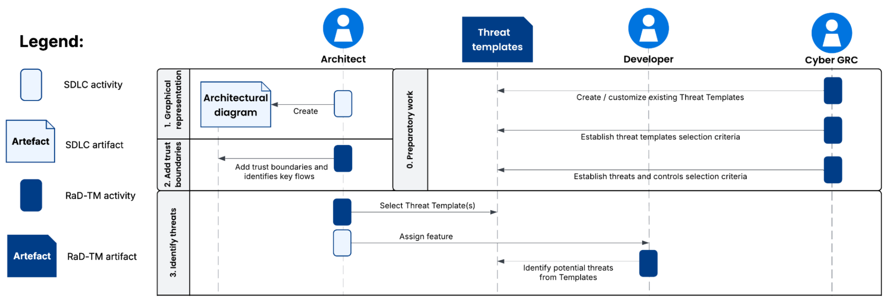
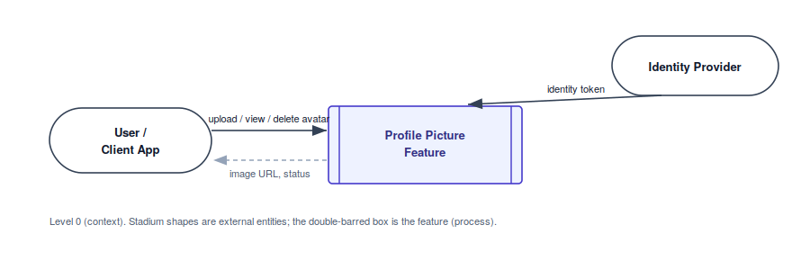
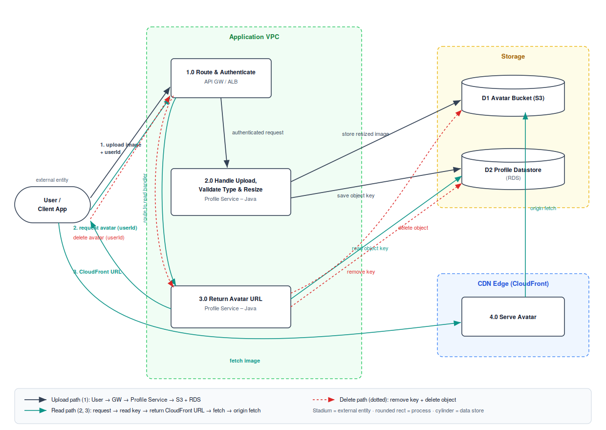
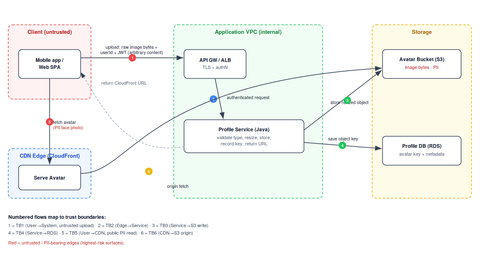
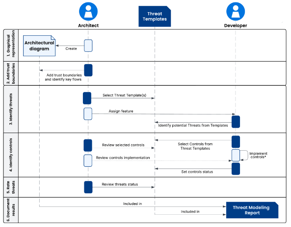
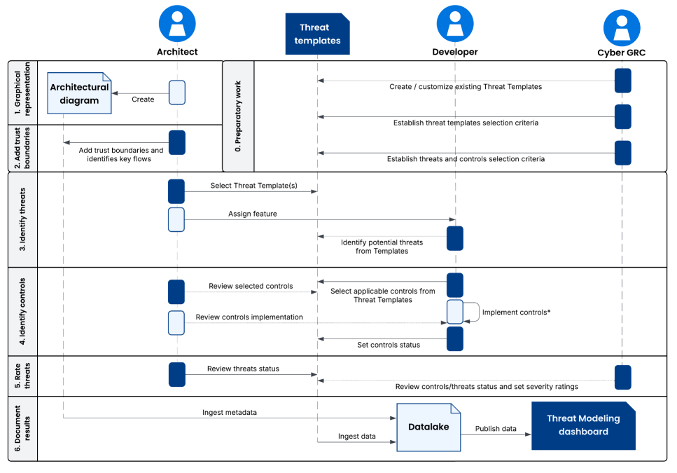
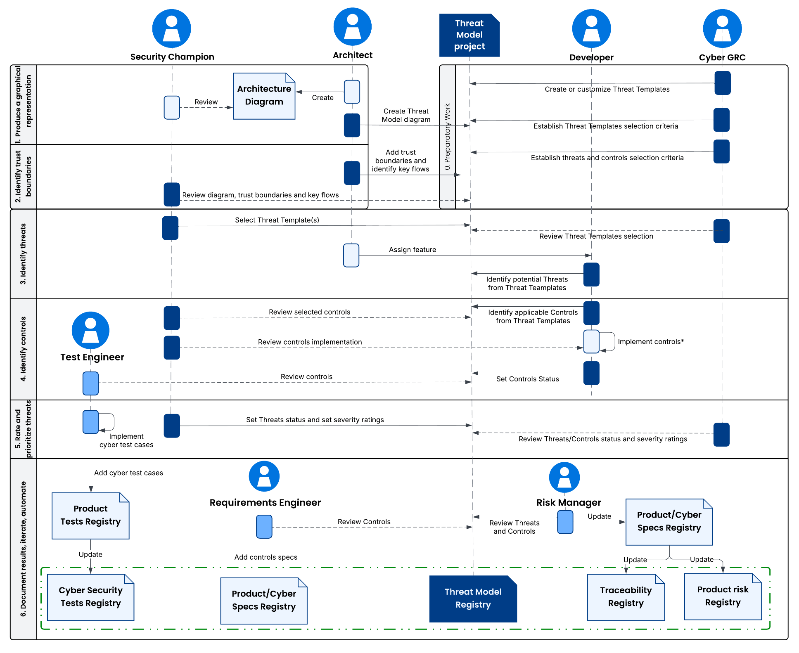

# OWASP Rapid Developer-Driven Threat Modeling (RaD-TM)

*Methodology and Integration Guide*

**Project Leaders**

- [Andrea Scaduto](mailto:andrea.scaduto@owasp.org)
- [Alan Pestrin](mailto:alan.pestrin@owasp.org)
- [Andrew Hainault](mailto:andrew.hainault@owasp.org)
- [Grant Ongers](mailto:grant.ongers@owasp.org)

## Table of Contents

- [Introduction](#introduction)
  - [Purpose of the guide](#purpose-of-the-guide)
- [Part 1 – The RaD-TM Methodology](#part-1--the-rad-tm-methodology)
  - [1. Overview](#1-overview)
    - [1.1 Core Benefits](#11-core-benefits)
    - [1.2 Feature-Level Threat Modeling](#12-feature-level-threat-modeling)
    - [1.3 Role of Threat Templates](#13-role-of-threat-templates)
    - [1.4 AI-Assisted Execution](#14-ai-assisted-execution)
  - [2. The RaD-TM Framework](#2-the-rad-tm-framework)
    - [2.1 Create a Visual Model](#21-create-a-visual-model)
    - [2.2 Identify Trust Boundaries](#22-identify-trust-boundaries)
    - [2.3 Apply Threat Templates](#23-apply-threat-templates)
    - [2.4 Assign Security Controls](#24-assign-security-controls)
    - [2.5 Evaluate Threat Severity & Status](#25-evaluate-threat-severity--status)
    - [2.6 Create Security Tasks](#26-create-security-tasks)
    - [2.7 Availability as an AI Skill](#27-availability-as-an-ai-skill)
    - [2.8 From Producing Artifacts to Validating Them](#28-from-producing-artifacts-to-validating-them)
  - [3. RaD-TM Deliverables](#3-rad-tm-deliverables)
    - [3.1 Diagram and trust boundaries](#31-diagram-and-trust-boundaries)
    - [3.2 Threat list](#32-threat-list)
    - [3.3 Control mapping](#33-control-mapping)
    - [3.4 Security backlog items](#34-security-backlog-items)
  - [4. Maintaining the Threat Model](#4-maintaining-the-threat-model)
- [Part 2 – Integrating RaD-TM in Your Organization](#part-2--integrating-rad-tm-in-your-organization)
  - [6. Designing the RaD-TM Process](#6-designing-the-rad-tm-process)
    - [6.1 Define Objectives and Scope](#61-define-objectives-and-scope)
    - [6.2 Identify Stakeholders](#62-identify-stakeholders)
    - [6.3 Design the process flow](#63-design-the-process-flow)
    - [6.4 Define Roles and Responsibilities (RACI)](#64-define-roles-and-responsibilities-raci)
  - [7. Implementing the Process](#7-implementing-the-process)
    - [7.1 Tool Identification and Selection](#71-tool-identification-and-selection)
    - [7.2 Process Implementation with Tools](#72-process-implementation-with-tools)
- [Part 3 – RaD-TM Templates & Examples](#part-3--rad-tm-templates--examples)
  - [8. RaD-TM Templates](#8-rad-tm-templates)
    - [8.1 Threat modeling process plan document](#81-threat-modeling-process-plan-document)
    - [8.2 SIPOC table and process diagram](#82-sipoc-table-and-process-diagram)
    - [8.3 RACI Matrix](#83-raci-matrix)
    - [8.4 Threat Templates](#84-threat-templates)
  - [9 Full Threat Model Example](#9-full-threat-model-example)
    - [9.1 Scenario](#91-scenario)
    - [9.2 Selected Threat Templates](#92-selected-threat-templates)
    - [9.3 Example Threat Model](#93-example-threat-model)
  - [10. Organizational Deliverables](#10-organizational-deliverables)
    - [10.1 Small organization (Kanban)](#101-small-organization-kanban)
    - [10.2 Medium organization (Scrum)](#102-medium-organization-scrum)
    - [10.3 Large organization (SAFe)](#103-large-organization-safe)

---

## Introduction

### Purpose of the guide

This guide is a practical, end-to-end reference for Rapid Developer-driven Threat Modeling (RaD-TM): a lightweight, feature-level threat modeling methodology designed to be performed by software developers as part of their normal development workflow, without requiring deep security expertise.

Traditional threat modeling attempts to model an entire application at once, depends on the availability of scarce security specialists, and tends to produce broad findings that are difficult to refine and maintain at scale. The result is a practice that does not keep pace with modern software delivery, and the adoption of AI coding assistants only widens that gap. RaD-TM closes it by narrowing the unit of analysis to a single feature, replacing open-ended threat brainstorming with expert-curated Threat Templates, and reducing the exercise to six repeatable stages that fit into a short session after the design phase and before development begins.

The guide serves two purposes:

- **Explain the methodology:** what the six stages are, what deliverables they produce, why Threat Templates are central to performing threat modeling without a security expert in the room, how a model is kept current as the feature evolves, and how each stage can be accelerated or automated with AI skills provided as part of the methodology.

- **Enable organizational adoption:** how to turn the methodology into a repeatable, documented process inside an organization, covering the definition of objectives and scope, stakeholder identification, process flow design, roles and responsibilities, and the selection of supporting tooling.

The material is organized in three parts. Part 1 sets out the RaD-TM methodology itself. Part 2 provides a step-by-step blueprint for designing and implementing the process in an organization. Part 3 collects worked examples and reusable artifacts, including a program plan template, a SIPOC process map, a RACI matrix, starter Threat Templates, and a complete sample threat model, which can be copied and adapted rather than written from scratch.

The methodology ships with AI skills that automate its two main activities: generating Threat Templates and producing a complete threat model for a feature. Both can be run automatically, turning a design document or existing code into a finished threat model in seconds, with Threat Templates reviewed by a security expert before use. Guidance on using these skills is deliberately spread throughout the document rather than confined to a single chapter. Chapter 5 describes how the AI skills perform each stage of the framework, and each process design section in Part 2 closes with an "In the AI-powered SDLC" subsection covering the additional considerations that apply when work is delegated to an AI assistant. Organizations not yet ready to introduce AI into their workflow can skip those subsections and still follow the methodology in full, since every stage can also be performed manually.

Scope and audience:

This guide covers the full lifecycle of feature-level threat modeling: the methodology, the deliverables it produces, the process required to operate it at organizational scale, and the artifacts needed to get started. Specifically, the following are in scope:

- The six-stage RaD-TM framework, applied to an individual feature or a discrete piece of functionality, and the four deliverables it produces: the diagram and trust boundaries, the consolidated threat list, the control mapping, and the security backlog items.

- The role of Threat Templates as the mechanism that grounds threat identification, together with pointers to the authoring and governance of templates.

- Maintenance of the threat model as features, integrations, and templates change over time.

- AI-assisted and AI-automated execution of the methodology, including its packaging as AI skills, and the organizational preconditions for introducing it.

- The design and implementation of the surrounding process: objectives and scope, stakeholders, process flow, RACI, and tool identification and selection.

- Example deliverables and templates that can be reused as a starting point.

The following are outside the scope of this guide:

- Quantitative risk assessment and residual risk determination. RaD-TM deliberately stops at severity ratings. Weighting impact and likelihood, accepting a threat, and evaluating residual risk depend on an organization’s risk appetite and belong to its own risk management process; this guide explains only how to interface with it.

- Application-wide and enterprise architecture threat modeling. The methodology can be applied to larger functionality in group sessions, but it is optimized for discrete features and is not a replacement for architecture-level review where an organization requires one.

- Vendor-specific tool configuration. Part 2 sets out criteria for identifying and selecting tools, not instructions for implementing any particular product.

- Adjacent security practices. Secure coding, security testing, vulnerability management, penetration testing, and incident response consume the outputs of threat modeling but are not described here.

The guide is written for everyone involved in producing or operating a threat model, and no prior threat modeling experience is assumed. Its primary audiences are:

- Developers, architects, security champions, and DevOps and SRE engineers who perform threat models on the features they build and deploy, and who own the resulting security backlog items.

- Product security engineers and other security specialists who create, review, and maintain the Threat Templates the methodology depends on, and who act as the escalation point for threats that fall outside them.

- Process and program owners, including security, GRC, risk, and quality managers, internal auditors, and agile coaches, who are responsible for designing the process, interfacing it with existing governance and risk processes, and demonstrating that security was addressed during development.

- Product owners, product and project managers, and technical leads who need to understand where threat modeling fits in the delivery cycle, what it costs, and who is accountable for each step.

- Data and AI/ML engineers and AI governance stakeholders, where the organization intends to have AI perform or support parts of the methodology.

Readers who only need to produce a threat model can work from Part 1 and the sample threat model in section 9. Readers responsible for rolling RaD-TM out across teams should read Part 2 alongside the example deliverables in Part 3.

---

## Part 1 – The RaD-TM Methodology

### 1. Overview

While threat modeling is widely recognized as a critical step in building secure software, traditional approaches often attempt to model an entire application all at once. This requires a comprehensive understanding of the system from various teams, including engineering, operations, and security, which can produce overly broad findings that are difficult to refine and maintain at scale.

In modern software development, the “shift-left” movement emphasizes addressing potential issues early in the development lifecycle. Our Rapid Developer-driven Threat Modeling (RaD-TM) empowers software developers to incorporate threat modeling seamlessly into the development workflow. It enables them to generate threat models for individual pieces of functionality after the earliest design phase to identify and address security threats - before development begins. This approach allows for quick turnarounds for security reviews and minimizes costly security rework later in the process.

#### 1.1 Core Benefits

The methodology is versatile and designed to fit different contexts:

- **Individual Use:** Developers can model the threats for features they are working on individually.
- **Group Sessions:** Teams can collaboratively model potential threats for larger functionalities or an entire application.

A further limitation of traditional threat modeling is its reliance on the specialized expertise of security professionals. Most developers are not trained to systematically identify or prioritize threats, which makes traditional threat modeling methods challenging to implement without expert guidance. As these experts are scarce, it limits both the scalability of threat modeling and its adoption across large or fast-moving development organizations. The goal of this methodology is to empower developers to perform effective, lightweight threat modeling on individual features during the development workflow without requiring deep security expertise. The methodology is based on simplicity, speed, and repeatability.

The methodology makes threat modeling accessible to all developers, not just security experts. Its lightweight nature ensures it does not add significant overhead to the development workflow. Moreover, it supports continuous refinement, allowing threat models to evolve alongside the application's functionality, and ensures that security remains integrated throughout the development lifecycle.

#### 1.2 Feature-Level Threat Modeling

RaD-TM works best when applied to a single feature or discrete piece of functionality being threat modeled, though it is not strictly limited to that scope. This feature-level focus is what keeps the methodology lightweight: each model can be produced in a short session following the requirements phase—where stakeholders identify, analyze, and document the necessary functionalities and constraints yet often overlook security considerations. Visualizing the feature's structure at this stage helps bridge the gap left by requirements, specifically capturing potential security-relevant data flows, interactions, and dependencies that might otherwise go unaddressed.

By equipping developers with a structured, accessible approach to feature-level threat modeling, we enable organizations to deliver more secure software while reducing the time and effort spent on addressing security issues later in the development process.

#### 1.3 Role of Threat Templates

Threat Templates introduce a novel approach to security standardization by eliminating the need for specialized security expertise. Rather than generating a massive threat model containing hundreds of items, our method focuses developers on identifying threats from a concise set of lists of up to 20 high-priority threats. These Threat Templates are pre-defined collections of threats and corresponding controls, each tailored to specific compliance standards, application environments, or organizational priorities. This streamlined structure guides developers—whether working individually or as part of a team—to systematically identify and mitigate threats, making security a more accessible and efficient process.

For best results, Threat Templates must be created and reviewed by a security expert. Refer to the dedicated section on Threat Templates in this paper for detailed guidance on how to develop and maintain these templates effectively.

#### 1.4 AI-Assisted Execution

To further reduce the effort required, the project provides AI skills that automate both parts of the methodology. The first skill generates Threat Templates tailored to a given compliance standard, application environment, or set of organizational priorities, giving security experts a strong starting point to review and refine rather than build from scratch. The second skill executes the full RaD-TM methodology on a feature: given a design document, user story, API specification, or existing source code, it produces a complete threat model in seconds, including the data-flow model, trust boundaries, identified threats, mapped controls, severity ratings, and a ready-to-file security backlog. Because threat identification is grounded in the expert-reviewed Threat Templates, the output remains consistent and repeatable, and developers can review, adjust, and iterate on the results as the feature evolves.

### 2. The RaD-TM Framework

There are six stages of the Rapid Developer-driven Threat Modeling (RaD-TM) framework:

1. Create a Visual Model
2. Identify Trust Boundaries
3. Apply Threat Templates
4. Assign Security Controls
5. Evaluate Threat Severity & Status
6. Create Security Tasks

The framework is designed to be quick, easy, and seamlessly integrated into the development workflow. By breaking threat modeling into smaller, well-defined steps, any developer can identify and address security threats without undue overhead.

AI changes both why RaD-TM matters and how it is performed. As AI coding assistants accelerate the pace at which features are designed and shipped, the attack surface grows faster than any expert-led, application-wide threat modeling process can review. RaD-TM is built for exactly this tempo: lightweight, feature-scoped, and embedded in the developer workflow, whilst its highly structured six stages make it unusually well-suited to automation.

Because the methodology constrains the problem (a bounded feature, a finite set of expert-curated Threat Templates, and a deterministic path from threats to controls to tasks), AI is not asked to reason about security from a blank page; it is given a well-defined problem with known inputs and outputs. Each stage below describes the manual steps first, followed by how AI can accelerate or automate that stage.

#### 2.1 Create a Visual Model

Start by creating a clear graphical representation of the functionality. This step should take no more than ten minutes per individual feature.

**Steps**

- **Identify the Feature:** Clearly define the feature or functionality being analyzed (e.g., "Transfer Funds Between Accounts").
- **Map All Elements:** Identify all components involved (e.g., user interface, APIs, databases, external services).
- **Illustrate Interactions:** Show how these elements interact, such as the flow of data between components:
  - Inputs: What data does the feature consume? How does it enter the system?
  - Outputs: What data does the feature produce? Where does it go?
  - Specify the type of data exchanged at each interaction (e.g., user credentials, tokens, requests, responses).

**With AI assistance**

AI can draft the model directly from the artifacts developers already produce, like a feature description, user story, design document, API specification, pull request, or the source code and infrastructure-as-code. AI can infer the components, interactions, and data flows that the developer would otherwise diagram by hand, collapsing the ten-minute manual step into a generated first draft.

More fundamentally, this raises a design question for the methodology: if the outcome of RaD-TM is an enumeration of threats and their controls, and AI can derive that enumeration directly from the feature's textual or code representation, then the diagram is no longer a required input, as the AI does not need a human-drawn picture to reason about the system.

In an AI-assisted flow the visual model is therefore best treated not as a mandatory first step but as an optional, automatically generated artifact: produced on demand so a developer can quickly verify that the AI understood the feature correctly, and retained as the audit deliverable (see 3.1). Skipping it altogether is possible, but the diagram remains the fastest way for a human to confirm the AI's understanding and to evidence that security was considered, so auto-generation is preferable to elimination.

#### 2.2 Identify Trust Boundaries

Once the functionality is mapped out, focus on identifying trust boundaries: points where the level of trust changes within the system. Trust boundaries are critical for pinpointing potential attack surfaces.

**Steps**

- **Locate Trust Boundaries:** Identify points where data crosses between:
  - Different trust levels (e.g., user-to-server, internal-to-external systems).
  - Privilege levels (e.g., regular user-to-admin system interactions).
  - Ownership domains (e.g., your application and third-party APIs).
- **Highlight Security-Relevant Transitions:** Mark transitions where sensitive operations occur, such as authentication, encryption, or data storage.

**Example**

- **User-to-System:** Input from the user into the application (e.g., login form submission).
- **System-to-Database:** Data exchanged between the application and its database.
- **Internal-to-External:** Interactions with third-party services or APIs.
- **Privilege Changes:** Where roles or permissions escalate (e.g., user-to-admin).

**With AI assistance**

Trust boundaries can likewise be inferred rather than hand-placed. From the same inputs used for the visual model, AI can detect where data crosses trust levels (user-to-system), privilege levels (user-to-admin), or ownership domains (first-party to third-party APIs) and highlight the security-relevant transitions where authentication, encryption, or sensitive storage occur.

As with the diagram, in a fully automated flow, boundary identification becomes an internal reasoning step the AI performs to scope which threats apply, surfaced to the developer for confirmation rather than executed as a manual exercise.

#### 2.3 Apply Threat Templates

Threat Templates empower developers to conduct threat modeling independently, reducing reliance on security experts. These concise, pre-defined collections of (max) 20 threats and corresponding controls are tailored to specific contexts, such as:

- Compliance Standards (e.g., FedRAMP, PCI DSS, HIPAA, GDPR).
- Deployment Environments (e.g., AWS, Azure, GCP, on-premises).
- Coding Guidelines (e.g., secure code best practices, NIST CSF, OWASP recommendations).
- Threat Modeling Frameworks (e.g., STRIDE).
- Platform Types (e.g., Low-Code / No-Code platforms).
- Organizational Priorities (e.g., vulnerability patterns or high-risk areas for the business).

Threat Templates streamline threat identification by focusing on relevant threats for a feature or system, ensuring no critical threats are missed. Their structured approach simplifies the process, enabling developers to work efficiently without requiring deep security knowledge.

**Steps**

- **Select a Threat Template Aligned to a Context** (reference chapter 9 and the project repository for sample Threat Templates):
  - Compliance Context (e.g., FedRAMP, PCI DSS, HIPAA, GDPR, Privacy).
  - Deployment Context (e.g., AWS, Azure, GCP, on-premises).
  - Implementation Context (e.g., threats due to common code vulnerabilities, STRIDE categories, Low-Code / No-Code platforms).
  - Organizational Priorities (e.g., threats identified from internal vulnerability management programs).
- **Match Threats to the Feature:** Identify threats from the template that apply to the feature's components or workflows.

Multiple threat templates can be selected depending on the audience working on the Threat Model. For example, in the context of a financial application within the scope for PCI DSS and deployed on AWS, developers can use the PCI DSS and Secure Code Implementation Templates while DevOps engineers can use the AWS Threat Template. Reference the full example for more information.

**With AI assistance**

This is where AI and RaD-TM fit together most naturally. The AI can help select the right Threat Template(s) for the feature in the first place, inferring from the feature's context which compliance, deployment, and implementation templates apply (e.g., PCI DSS plus AWS plus Secure Code Implementation) and flagging where the choice is ambiguous for a human to confirm.

From there, because the templates are pre-defined, finite, and security-reviewed, they act as a retrieval context that constrains the model: the AI matches the threats in the selected template(s) to the feature's components and workflows, consolidating those in scope into a single, de-duplicated list for the feature. The curated template is precisely what keeps the output grounded. The model selects from a known set of expert-validated threats rather than inventing them, which sharply reduces hallucination and produces consistent results across features, developers, and teams.

The discipline that has always defined a good template (keeping it finite and tightly scoped to one context) pays off differently once the AI is the consumer rather than a person reading by hand. A short, non-redundant candidate set is what keeps matching precise and run-to-run consistent, and it keeps the cross-template consolidation clean. The justification for the 20-threat constraint shifts from bounding what a developer can review manually to preserving the retrieval quality the model depends on, but the constraint itself becomes more valuable, not less.

#### 2.4 Assign Security Controls

For each threat identified, developers select corresponding pre-approved controls from the same Threat Template while having the flexibility to incorporate additional security measures as needed. These controls should align with:

- Compliance Standards (e.g., PCI DSS requirements, NIST 800-53, HIPAA, Privacy regulations).
- Deployment-Specific Guidance (e.g., AWS Well-Architected Framework, Azure and GCP security baselines).
- Secure Coding Best Practices (e.g., OWASP recommendations).
- Internal Security Policies (e.g., mandated libraries, APIs, or business processes).

**Steps**

- **Identify Controls:** For each threat, list the controls provided in the Threat Template.
- Evaluate Implementation:
  - Implemented: Control is operational and effective.
  - Partially or not implemented: Control exists but has gaps or is missing.
- **Document Implementation Rationale:** Provide reasons for the control's implementation status.

**With AI assistance**

For each matched threat, AI proposes the corresponding pre-approved controls from the same template. It can go further than a manual reviewer by inspecting the codebase or infrastructure-as-code to offer an initial assessment of each control's status (implemented, partially implemented, or not implemented) together with a draft rationale. The developer confirms or corrects this assessment rather than compiling it from scratch.

#### 2.5 Evaluate Threat Severity & Status

For each identified threat, perform the following steps.

**Steps**

- **Assess Severity:** Update the default severity rating of High, Moderate, or Low based on the likelihood of the threat occurring, its potential impact, and on the controls which have already been fully or partially implemented as documented in Assign Security Controls. Note: Each threat in a Threat Template typically comes with a default severity rating to streamline evaluation and prioritization.
- Determine Threat Status:
  - Mitigated: The threat has been fully addressed through implemented controls.
  - Accepted: The threat is acknowledged and accepted because of low likelihood, minor impact, or a business decision.
  - Open: The threat remains unaddressed due to incomplete or missing controls.
- **Provide Rationale:** Briefly explain why the threat is categorized as mitigated, accepted, or open. Propose actions or mitigations to address the remaining threats.

Focus on high-severity unmitigated threats first and prioritise low-severity threats for later review.

**Note:** Risk assessment considerations, including residual risk evaluation, are inherently tied to an organization's specific risk appetite and security posture. These aspects involve subjective judgments on impact and likelihood, which can vary significantly between organizations based on their controls and priorities. As such, they extend beyond the scope of this methodology, which focuses on a streamlined, developer-friendly approach to identifying and addressing threats. Instead of using risk ratings, we focus solely on severity ratings, simplifying the process while maintaining a practical approach to security. By avoiding complex risk assessments, we improve the chances of developer adoption, ensuring security is integrated efficiently without unnecessary overhead.

**With AI assistance**

AI can apply the template's default severity ratings and propose adjusted severities, with rationale, based on the controls it found already in place. Consistency is a particular strength here, as the model applies the same logic across every feature it processes.

The judgments the methodology deliberately reserves for human discretion (impact, likelihood, and the decision to accept a threat against the organization's risk appetite) remain with the developer or security champion, who adjusts the AI's proposal rather than originating it.

This presupposes that the severity scheme is itself defined and agreed beforehand. Both the meaning of the rating bands and the per-threat defaults must be established by the relevant stakeholders and recorded in textual form (in practice, inside the Threat Templates) so they can be given to the AI as input. The model proposes adjustments against that agreed baseline; it does not originate it. Without a shared definition of what High, Moderate, and Low mean, the AI's rating and a reviewer's would not share a yardstick, and the consistency the approach is credited with would be illusory.

#### 2.6 Create Security Tasks

Translate the outcomes of the evaluation into actionable security work items that developers and DevOps engineers can pick up as part of their normal workflow. For every Open threat, and for Partially implemented controls, capture a corresponding task that describes the gap, the proposed mitigation, and the affected components.

**Steps**

- **Convert Open Threats into Work Items:** For each threat with status Open or Partially implemented, create a ticket (e.g., in Jira, Azure DevOps, GitHub Issues) describing the gap and the required mitigation.
- **Link to the Threat Model:** Reference the threat ID, affected components, and suggested controls so the task is traceable back to the model.
- **Prioritize by Severity:** Use the severity rating assigned in the previous step to drive backlog priority, tackling high-severity items first.
- **Assign Ownership:** Route tasks to the appropriate owner (developer, DevOps, security champion) based on the component and control type.

**With AI assistance**

AI can translate every Open threat and every Partially implemented control into work items generated directly in the team's tracking system (Jira, Azure DevOps, GitHub Issues, etc.), pre-populated with the threat reference, affected components, proposed mitigation, severity-based priority, and suggested owner. What is normally a manual transcription step becomes an automatic hand-off into the existing backlog, fully traceable back to the model.

#### 2.7 Availability as an AI Skill

To make this AI-assisted workflow concrete, RaD-TM is also packaged as a set of skills: self-contained instruction modules that an AI assistant loads on demand to perform the methodology. The suite comprises two complementary skills.

- **The modeling skill** runs the full six-stage framework against whatever a developer already has (a feature description, design document, API specification, or the source and infrastructure-as-code itself) and produces the complete set of deliverables: a data-flow model, trust boundaries, a consolidated threat list, a control mapping with evidence-based implementation status, a severity evaluation, and a ready-to-file security backlog.
- **The template-authoring skill** is the security expert's counterpart: it supports creating, deriving, reviewing, versioning, and governing the Threat Templates that ground the whole process.

The two form a deliberate supply chain: experts curate the templates, developers consume them, and gaps surfaced during modeling feedback into template maintenance.

Crucially, the skills encode the methodology's core discipline directly. Threats are selected only from the curated templates, never invented. The diagram is treated as an auto-generated artifact for human verification rather than a manual prerequisite. And the judgments that depend on organizational risk appetite (accepting a threat, weighting impact and likelihood) are always handed back to a person.

In this form RaD-TM becomes not just a method a developer follows, but one an AI assistant can perform alongside them, at the speed the modern SDLC demands, while keeping security expertise and human judgment exactly where the methodology intends.

#### 2.8 From Producing Artifacts to Validating Them

Taken together, AI shifts the developer's role from producing the artifacts to validating them. The stages that exist largely to help a human reason about the system (the visual model and trust boundaries) can be auto-generated, or performed internally by the model and surfaced only for confirmation. The stages that produce the methodology's actual output (threats, controls, severities, and tasks) are enumerated automatically and reviewed by the developer.

Two elements remain deliberately human: the Threat Templates, which must still be created and maintained by security experts and which act as the guardrail keeping AI output relevant and grounded; and the contextual risk decisions that depend on organizational appetite.

The same automation extends to maintenance, where AI can monitor a feature for new components, data flows, or integrations and flag when its model has drifted and should be re-run. And because the AI-powered SDLC introduces its own classes of risk, from insecure AI-generated code to threats inherent in AI features themselves, these can be captured as dedicated, technology-specific Threat Templates and run through the identical six-stage process.

### 3. RaD-TM Deliverables

Applying the framework to a feature produces a concise, shareable set of deliverables. Together, they form the threat model record that lives alongside the feature in the team's tracking system and provides a clear audit trail proving security was addressed during development.

#### 3.1 Diagram and trust boundaries

A visual representation of the feature—showing its components, interactions, and data flows—together with the list of trust boundaries identified within the system. Each trust boundary includes one or more nodes from the diagram and highlights where sensitive operations or trust transitions occur. This diagram sets the foundation for identifying security threats.

#### 3.2 Threat list

A list of threats relevant to the feature based on the selected Threat Template(s). Each entry records the threat name and description, its default severity, and the applicable components of the feature. When multiple templates are in scope (e.g., PCI DSS plus AWS plus Secure Code Implementation), threats from each are consolidated into a single list for the feature.

#### 3.3 Control mapping

A mapping of each identified threat to the suggested controls from the selected Threat Template, specifically designed to mitigate the risks posed by the threat. For each threat–component pair, the mapping records whether controls are implemented, partially implemented, or not implemented, along with a short rationale explaining the current status.

#### 3.4 Security backlog items

A set of work items derived from the evaluation step, covering every *Open* threat and every gap left by *Partially* implemented controls. Each item includes the threat reference, affected components, proposed mitigation, severity-based priority, and assigned owner—feeding directly into the team's existing backlog.

In addition, a concise summary report should be produced that ties these deliverables together and includes:

- Feature description
- List of identified threats and linked controls
- Control implementation status and accepted threats
- Mitigation plans for any unaddressed issues

Store the threat model in the same ticket or feature record (e.g., Jira, Azure DevOps), ensuring easy access for the entire team.

### 4. Maintaining the Threat Model

A threat model is not a one-off artifact. To stay useful, it must evolve alongside the feature it describes and the broader threat landscape.

Integrate threat modeling into routine workflows (e.g., feature refinement or sprint planning). Leverage checklists, templates, or automated tools to generate or update models automatically, reducing manual overhead and fostering continuous security awareness.

Whenever a feature changes (new components, new data flows, new integrations, or changes to trust boundaries) the existing threat model should be revisited. In practice, this means:

- **Refresh the diagram and trust boundaries** to reflect the updated design before development begins on the change.
- **Re-apply the relevant Threat Templates** so that any new threats introduced by the change are picked up, and previously identified threats are re-evaluated against the new design.
- **Reassess controls and severity** for each affected threat, updating the implementation status and rationale as controls are added, removed, or modified.
- **Refresh the security backlog** by opening new tasks for newly identified gaps and closing items that are no longer applicable.
- **Reflect template updates** when the underlying Threat Templates are revised (for example, due to new compliance requirements, emerging threats, or lessons learned from incidents), re-running the affected feature models against the new template versions.

By treating the threat model as a living artifact tied to the feature record, teams ensure security remains integrated throughout the development lifecycle rather than being a point-in-time exercise.

With AI assistance

Maintenance is where manual threat modeling most often breaks down: models are created once and quietly drift out of date. AI turns revisiting the model from a step someone must remember into one that is triggered automatically, applying the same six-stage process to the change rather than to the whole feature.

- **Detect drift:** AI can monitor the artifacts that describe a feature (design documents, API specifications, pull requests, source code and infrastructure-as-code) and flag when a change introduces new components, data flows, integrations, or trust boundary crossings. Flagging can happen at the pull request, so the model is revisited before the change ships.
- **Re-run only what changed:** Because the model is derived from the feature's textual and code representation, AI can regenerate the diagram and trust boundaries and present them as a diff against the previous version. The developer confirms the change in understanding rather than redrawing the model.
- **Re-apply templates to the delta:** AI matches the change against the selected Threat Templates, adding newly applicable threats and re-evaluating existing ones whose components or flows were touched. Threats are still selected only from the curated templates, never invented.
- **Re-check control status from evidence:** AI can re-inspect the code and infrastructure to detect controls that were added, weakened, or removed by the change, and propose updated implementation status, severity, and rationale against the agreed severity baseline.
- **Keep the backlog in sync:** AI can open work items for new gaps and propose closing items that the change has made obsolete, citing the evidence. Closing an item and accepting a threat remain human decisions.
- **Propagate template updates:** When security experts publish a new template version, AI can identify every feature model that used the affected template and re-run them against the new version, surfacing which features gained new open threats.

The division of labour stays the same as in the initial model. AI detects, regenerates, and proposes; the developer or security champion confirms the updated model and owns any risk-acceptance decisions; and security experts remain responsible for revising the Threat Templates themselves. Each re-run also leaves a dated, versioned record of how the model changed, which serves as audit evidence that security was reconsidered as the feature evolved.

---

## Part 2 – Integrating RaD-TM in Your Organization

### 6. Designing the RaD-TM Process

This section starts from the assumption that your organisation does not have an existing Threat Modeling process and therefore describes the process of designing and integrating Threat Modeling from scratch. Note that whilst the focus is on RaD-TM, many of the steps are common across threat modelling techniques and approaches in general.  
For those organisations that already perform threat modelling, RaD-TM is not intended as a wholesale replacement of the process but instead can be considered as another tool in your threat modelling toolkit, or as an alternative methodology, analogous to Agile development vs. waterfall development.  
The main shift is that developers are first in line to perform threat modelling, using RaD-TM templates, whilst the security team's role moves upstream, changing from running sessions to authoring, reviewing and maintaining the templates, drawing on past threat models, security findings and incidents. You can maintain current methods for system and architecture-level reviews, then use RaD-TM to model the feature changes in between. Notably, RaD-TM has also been designed with AI-driven automation in mind.

#### 6.1 Define Objectives and Scope

The first step in integrating RaD-TM into your organization is to clearly define the scope and objectives to be achieved. Establishing these boundaries and goals early on is critical, as they will guide every subsequent decision in the definition and design of the threat modeling process. The determination of scope and objectives should be informed by the following factors:

- **Organization type and size**: The approach will differ significantly depending on whether the organization is a startup, a small-to-medium business, or a large enterprise, as each presents distinct structural constraints, risk appetites, and resource capacities.
- **Industry and regulatory context**: Organizations operating in regulated industries such as healthcare, finance, or critical infrastructure face specific compliance obligations (e.g., HIPAA, PCI-DSS, NIS2) that must be considered in defining scope and goals
- **Threat modeling maturity:** Whether threat modeling is already practiced within the organization, and if so, the quality of past results, identified gaps, and lessons learned, should heavily influence the starting point and ambition of the integration effort.
- **Existing organizational goals and requirements**: The integration of RaD-TM should align with broader business and security objectives, which can simply be reducing the overall risk exposure to security risks of applications in scope by integrating RaD-TM in the secure software development lifecycle (SSDLC), achieving compliance with specific standards or frameworks, etc.
- **Current risk exposure:** Recent security incidents, findings from audits and assessments, known vulnerabilities, and the overall threat landscape relevant to the organization should be used to prioritize focus areas and calibrate the scope accordingly.
- **Available resources:** The feasibility of the integration depends on the availability and willingness of teams to participate in threat modeling activities, the level of in-house security expertise, tooling availability, and budget constraints.
- **Technology landscape and architecture complexity:** The diversity and complexity of the organization's systems, applications, and infrastructure (e.g., cloud-native, hybrid, legacy systems, third-party dependencies) will directly impact the scope and depth of threat modeling that can realistically be performed.
- **Development methodology and pace:** The organization's software development approach (e.g., Agile, DevOps, waterfall) and release cadence should be considered to ensure that threat modeling activities can be integrated into existing workflows without creating friction or bottlenecks.
- **Stakeholder landscape and organizational culture:** Identifying key stakeholders and understanding the organization's cultural attitude toward security and threat modeling will help define realistic objectives and shape the change management strategy needed for a successful adoption.

While the scope definition shall include clear requirements addressing the following dimensions:

- **Threat modeling granularity and level of abstraction**: Specify at which level(s) threat modeling will be performed. This may range from high-level, architecture-wide threat models covering entire applications or systems, down to more focused analyses at the feature level.
- **Applications and systems in scope**: Define which applications will be subject to threat modeling. This could include a curated set of high-priority applications, all applications embedded in products with compliance or regulatory obligations, newly developed applications above a certain risk threshold, or the entire application portfolio over time as the program matures.
- **Categories of security risks in scope**: to be later used to determine which threat templates to use, e.g.:
  - STRIDE for initial high-level threat modeling of entire applications.
  - Deployment environment (e.g. CSP-specific) security risks only.
  - Technology-specific (e.g. AI) security risks only.
  - …

The objectives for designing a threat modeling program shall include: 

- **Alignment with organizational goals and strategic drivers**: Objectives should explicitly reference the broader organizational goals they support (e.g. perform cybersecurity risk assessments, adopt OWASP SAMM framework, be compliant with NIST CSF and reach Tier 4 maturity, etc.).
- **List of existing processes to interface RaD-TM with**: Examples include enterprise risk management framework, issue management process, etc.
- **Desired output and usage**: Clearly define what the threat modeling process is expected to produce and how those outputs will be consumed (e.g. identified threats and related controls to be used as input to evaluate risks in product security risk assessments, etc.).
- **Operationalization aspects and triggering criteria**: Examples include initiating threat modeling whenever a feature with cybersecurity relevance is planned, when a new third-party component or service is introduced, when the deployment environment changes significantly, etc.
- **Success and acceptance criteria**: Establish clear, measurable criteria that define what a successful threat modeling exercise looks like and what requirements has, e.g. no residual threats with severity greater than medium prior to application release.

A set of high-level requirements to define the scope and objectives to be set for the first roll out of RaD-TM in your organization shall be created and documented in a threat modeling process plan document. 

A template for documenting the threat modeling plan is provided in Section 8.1, while examples of completed plans are available in Chapter 10.

Such threat modeling plan is intended to be:

- Used as a starting point to design the threat modeling process which will be used to integrate RaD-TM shaped around the specific organizational needs and characteristics.
- Iteratively updated and improved based on feedback collected from participating teams, lessons learned from completed threat modeling activities, changes in the organization's risk landscape, and updates to systems, processes, or regulatory requirements.

**Define Objectives and Scope in the AI-powered SDLC**

To enable AI to perform or support the execution of RaD-TM and its stages as described in chapter 5, additional organizational factors should be considered while defining objectives and scope, including:

- **AI governance maturity**: existence of governance frameworks (and related processes) which would enable a smooth (but reviewed and controlled) introduction of AI-based RaD-TM in the organization without blockers and limiting the exposure to related relevant risks.
- **AI technological maturity / AI asset inventory**: availability of internal or 3rd party AI platforms/orchestrators approved for use which would enable the development and seamless integration of AI skills and agents to perform RaD-TM within the organization.
- **Overall technological, process and data maturity and consistency**: in order to shift the responsibility to AI of executing some of the RaD-TM steps, producing and processing related artifacts, it is essential to have defined and consistent SDLC processes and practices, and common tools adoption (e.g. common developer platforms, data management tools, etc.) to facilitate the implementation and roll out of AI skills and agents capable of reaching and interfacing with the entire set of applications and development environments intended to be included in the scope.

#### 6.2 Identify Stakeholders

Following the objectives and scope requirements identified in the previous section, stakeholder identification constitutes the next critical step in the process of integrating RaD-TM in your organization. 

Begin by compiling a comprehensive list of teams and roles across the organization, extending beyond software development, whose involvement would add value to the threat modeling effort. Teams and roles which usually get involved in threat modeling are:

- SW development team
  - Architects
  - Developers
  - Security champions
  - DevOps engineers
  - Site reliability engineers
  - QA/Test engineers
  - Scrum masters / agile coach
  - Requirement engineers
  - Technical writer
- Management
  - Project managers
  - Product managers
  - Product owners
  - Technical leads
- Quality team
  - Quality managers
  - Quality analyst
  - Internal auditors
- Governance and compliance
  - GRC analysts
  - GRC managers
- Risk team
  - Risk managers
  - Risk analysts
- Security teams
  - Product security engineers
  - Cyber GRC analysts

Then, considering the scope and objectives previously defined and the type and number of roles and stakeholders listed, identify the main steps which will constitute the threat modeling process and which such identified roles can perform including:

- The RaD-TM methodology 6 main steps.
- If applicable, additional extra steps like:
  - preparatory activities to be performed (e.g. creation and/or customization of threat templates if the organization has roles with expertise to do so):
  - steps to be included to implement and enable the interfaces with other organizational processes.
- Set of potential roles which can be involved in each step.

As soon as the main steps which constitute the threat modeling process are identified, link each of such steps with the list of roles which can be involved in performing or supporting in the execution of such steps. 

**Identify Stakeholders in the AI-powered SDLC**

In addition to the list of stakeholders included in section 6.2.:

- Other stakeholders should be considered like data and AI/ML engineers to enable the development, integration, maintenance and support of relevant resources and systems which enable AI-based RaD-TM in the organization.
- The inclusion of an "AI assistant" role in this phase should also be considered, since, as described in chapter 5, AI can be used to perform entire steps of the RaD-TM methodology and produce related artifacts.
- Since AI increases the involvement of human roles in review and validation tasks (rather than execution tasks), more roles should be in principle considered to be included, including less technical ones which do not belong to development teams.

#### 6.3 Design the process flow

From the scope and objective requirements and the steps and roles relations identified in the previous phase, define and create a SIPOC table in which:

- Steps are reordered according to their dependency and the intended execution flow.
- Sub steps are added if needed (e.g. the existence of product security and cyber GRC teams within the organization enables the customization of threat templates at organizational level, etc.)
- Steps and sub steps are uniquely identified.
- Main input and output artifacts are included.
- Main responsible role (among the ones selected in the previous table for each step) is pointed out for each step and sub step.

In addition to the SIPOC table, create a process diagram (e.g. BPMN diagram, process sequence diagram, etc.) as well to depict the overall process, the order of execution and the interactions of each step with the involved stakeholders and with the other organizational processes in scope.   
In addition to enabling a graphical representation of the entire process and its interactions, such diagrams facilitate stakeholders to understand how tasks, decisions, and roles interact with each other in a more intuitive and direct way.

Refer to the example provided in section 8.2 for templates to be used to document such SIPOC table and process sequence diagrams and to Chapter 10 for complete examples of such deliverables in different types of organizations. 

**Design the process flow in the AI-powered SDLC**

In designing the process flow and specifically in defining its steps:

- Consider to group together steps which can be fully performed by AI (e.g. "Create a visual model" and "Identify trust boundaries").
- Differentiate between "execution" and "review/validation" steps and document them separately.
- Clearly indicate which steps are intended to be performed by AI and which ones by human roles.
- Clearly indicate which type of artifacts will be produced by AI and which ones will be used by human roles to include review/validation results

#### 6.4 Define Roles and Responsibilities (RACI)

After having designed the overall threat modeling process, its steps and having identified the responsible roles for each of such steps, the involvement of other relevant stakeholders in each step shall be defined and documented in a RACI matrix. Specifically, for each step included in the process, one or more of these types of responsibility shall be assigned:

- Responsible
- Accountable
- Consulted
- Informed

Refer to the example provided in section 8.3 for a template to be used to document such RACI matrix and to Chapter 10 for corresponding examples. 

**Define Roles and Responsibilities (RACI) in the AI-powered SDLC**

In defining roles and responsibilities and documenting them in the RACI matrix, please ensure to:

- Make any "AI assistant" role(s) defined in section 6.2 responsible for performing applicable "execution" steps.
- Always set one or more human roles as accountable for each step of the process, including the ones performed by AI.

As soon as the threat modeling process artifacts described in this chapter are created and documented:  
•   Plan with scope and objectives  
•   SIPOC table   
•   Diagram  
•   RACI matrix

A review round involving the main stakeholders managing the involved processes and teams needs to be conducted to validate the process design, identify gaps, and ensure cross-functional alignment, collect feedback and update the process accordingly.

### 7. Implementing the Process

#### 7.1 Tool Identification and Selection

The first step to be performed to define how the threat modeling process designed in the previous chapter will be implemented is listing relevant tools (3rd party or internal ones) already in use in the organization. Specifically, tools used for:

- **Creating architecture diagrams** to be used in the first 2 steps of RaD-TM.
- **Managing governance processes** to track and manage the overall threat modeling process.
- **Tracking information and assets** to efficiently manage threat templates and their contents.
- **Implementing data platforms and warehouses** to store, analyze and process across the organization relevant data.
- **Software lifecycle management tools** to track tasks and work items created during the threat modeling process.

Similarly to what has been done in the previous chapter with the stakeholders listing and selection in designing the threat modeling process, the implementation of each step of the designed threat modeling process shall be linked with tool(s) which can potentially be used or reused to perform such steps.

In case there are no tools available to perform a certain step of the process, other 3rd party tools not yet available within the organization should be considered.

#### 7.2 Process Implementation with Tools

For each step included in the designed threat modeling process, one or more tool(s) to be used to implement such steps and to process the related data needs to be identified and documented. Documentation shall include:

- **Tool’s name and version**.
- **Related RaD-TM process step(s)**: the process step(s) identified and documented as per previous sections of this document in which the tool will be used.
- **Description**: of task(s)/activities such tool is intended to be used for the identified steps, including related I/O interfaces with other tools and systems and related artifacts.
- **Status**: current availability in the organization and description of any related existing requirement/constraint/limitation (e.g. not currently available, available but with licensing constraints, only certain features are available / modules have been purchased, etc.)
- **Action plan:** needed to perform in order to operationalize the tool in executing the identified task(s).

---

## Part 3 – RaD-TM Templates & Examples

### 8. RaD-TM Templates

#### 8.1 Threat modeling process plan document

Users may adopt any documentation approach they find suitable for the threat modelling process plan outlined in section 6.1, including the one provided in this section.

**1. Purpose and intent**

This document defines the scope and objectives for the first rollout of threat modeling within *\[Organization Name\]*, using the RaD-TM methodology as the foundation. It serves as the starting point for designing a threat modeling process shaped around the specific needs and characteristics of the organization.

This plan is intended to be iteratively updated and improved based on:

- Feedback collected from participating teams
- Lessons learned from completed threat modeling activities
- Changes in the organization's risk landscape
- Updates to systems, processes, or regulatory requirements

**2. Organizational context**

This section captures the key organizational factors that inform the definition of scope and objectives. 

**2.1 Industry and regulatory context**

List any applicable compliance obligations or regulatory frameworks that must be considered in defining the scope and objectives.

Applicable regulations and standards may include, but are not limited to:

- [ ] HIPAA
- [ ] PCI-DSS
- [ ] NIS2
- [ ] ISO 27001
- [ ] SOC 2
- [ ] GDPR
- [ ] NIST CSF
- [ ] Other: \[Specify\]

*\[Insert additional context here\]*

**2.2 Threat modeling maturity**

Describe the current state of threat modeling within the organization. If threat modeling has been practiced previously, summarize the quality of past results, identified gaps, and lessons learned that should influence the starting point and ambition of this integration effort.

Current maturity level (select one):

- [ ] No prior threat modeling practice
- [ ] Ad hoc or informal threat modeling performed occasionally
- [ ] Threat modeling performed on some projects with inconsistent methodology
- [ ] Structured threat modeling practice in place, with documented process and results

*\[Insert description of past experience, gaps, and lessons learned\]*

**2.3 Existing Organizational goals and requirements**

List the broader business and security objectives that this threat modeling program is expected to support or align with.

Examples:

- Reduce overall risk exposure of applications in scope by integrating threat modeling into the SSDLC
- Achieve compliance with *\[Standard/Framework\]*
- Support product security certification for *\[Product/Market\]*

*\[Insert list of organizational goals and requirements\]*

**2.4 Available resources**

Document the resources available to support the threat modeling program, including personnel, tooling, and budget. Note any constraints that may affect feasibility or scope.

| Resource Category | Details |
| :---- | :---- |
| Development team capacity | *\[e.g. 2 FTEs available part-time\]* |
| In-house security expertise | *\[e.g. application security, cloud security\]* |
| Tooling available | *\[e.g. tool A, tool B, etc.\]* |
| Budget | *\[e.g. Allocated / To be defined\]* |
| Participating teams | *\[e.g. Team A, Team B — confirm willingness\]* |

**3 Scope and goals**

This section defines the intended application scope and objectives for the rollout of the threat modeling program based on the RaD-TM methodology.

**3.1 Applications in scope**

If known, provide the full list of applications in scope of this initiative.  
Alternatively, define the criteria/logic to be used (or to be established) to identify the applications in scope which will be threat modeled using RaD-TM, e.g. based on factors used by the organization to measure the level of exposure of applications in scope to relevant security risks.

Examples:

- All applications which are integrated in or used by *\[ProductName\]*
- All applications which *\[are customer facing and process confidential or strictly confidential data\]* according to the *\[Organization Data Classification Policy/Standard\]*

**3.2 Processes to interface RaD-TM with**

List the organizational process(es) which must or should interface with RaD-TM and rationale. In doing so, include any relevant requirement(s) which must be taken into account in designing the interface and the interaction between the process and RaD-TM.

Examples:

- Process name: *\[SW architecture & design process\]*
- Requirements:
  - *\[Threats models shall be created/updated for each approved ADR (Architecture Decision Record)\]*
  *   
- Process name: *\[Process to request access to the cloud\]*
- Requirements:
  - *\[The RaD-TM process shall be executed using CSP-specific threat templates each time application teams request access to production cloud landing zones\]*

**4 Roadmap & OKRs**

Document a proposed roadmap in order to provide a consolidated, at-a-glance view of how the threat modeling program using RaD-TM will be deployed across the organization over time. In doing so include OKRs, rollout phases, timelines and related key activities to translate the program vision into measurable objectives, planned execution steps, and clear delivery expectations.

**Example**

| Phase | Timing | Key Activities | OKRs |
| :---- | :---- | :---- | :---- |
| *\[Phase 0 - Setup\]* | *\[2026Q4\]* | *\[Document process & tools\] \[Identify & involve stakeholders\]* | *\[Threat model plan and process approved by CISO\] \[Identified users for following roles: …\]* |
| *\[Phase 1 - Pilot\]* | *\[2027Q1\]* | *\[Select/Create threat templates\] \[Test the process on App1\]* | *\[Threat model created on App1\] \[Requirements refined and documented in threat modeling plan\]* |
| *\[Phase 2 - …\]* | *\[...\]* | *\[...\]* | *\[...\]* |

#### 8.2 SIPOC table and process diagram

With respect to the SIPOC table and process diagram presented in section 6.2, users retain the autonomy to determine their preferred documentation and structuring methodologies including relying on relevant templates provided by diagramming and visual collaboration tools.

At a high level, SIPOC table and process diagram templates may be represented as follows to document the following information:

- Each RaD-TM step and sub steps
- Interactions with SDLC activities and processes
- Related RaD-TM artifacts
- Responsible stakeholder(s)

SIPOC table:

| STEP | NAME | DESCRIPTION | INPUT/OUTPUT | RESPONSIBLE |
| :---- | :---- | :---- | :---- | :---- |
| *\[#step number, e.g. #10\]* | *\[Step name, e.g. RaD-TM step 1 - create a visual model\]* | *\[Description of task performed in this step,e.g. Identify the feature to be threat modeled, identify all components involved and dataflows\]* | *\[List of input and output deliverables of this step, e.g.Input: requirements Output: architecture diagram\]* | *\[Role(s) responsible for this step. E.g. SW architect.\]* |
| … | … | … | … | … |

Process sequence diagram:  

#### 8.3 RACI Matrix

Users are permitted to select their preferred method for documenting the RACI matrix. For illustrative purposes, an example RACI matrix is provided below:

| STEP | *\[role 1, e.g. SWA architect\]* | *\[role 2, e.g. Security Champion\]* |  |
| :---- | :---- | :---- | :---- |
| *\[#step number, e.g. #10\]* | *\[responsibility type, e.g. R, A\]* | *\[responsibility type, e.g. C, I\]* |  |
|  |  |  |  |

#### 8.4 Threat Templates

These are the bundled **starter** templates. A public set of threat templates is available in the project repository as a ready-to-use starting point, and the repository also ships an **AI skill for authoring new threat templates** — tailored to an organization's most important threats and its own approved controls — so that production threat models run against the organization's reviewed templates rather than the generic starters. The starters are working examples, not a substitute for expert review: an organization should review, trim, and extend them (or generate its own) before relying on them in production.

### 9 Full Threat Model Example

#### 9.1 Scenario

The design document below describes the User Profile Picture Upload feature for a mobile and web banking application, which lets customers add, replace, or remove a profile avatar. It sets out the feature's context, goals, high-level architecture, data flows, API surface, and non-functional requirements.  
This specification is provided to the RaD-TM skill as input for generating a threat model. It is only an example: RaD-TM can work from design documentation for a feature that hasn't been built yet, or from source code for one that already exists.

**User Profile Picture Upload Design Document**

| Status | Final (approved for build) |
| :---- | :---- |
| **Applies to** | Mobile + Web banking app |
| **Date** | 2026-06-30 |

The banking application allows customers to maintain a profile. This feature adds the ability for a user to add, replace, or remove a profile picture (avatar) on that profile. It is a personalisation / convenience feature that helps users and staff recognise accounts. The wider application is in PCI DSS scope. This feature does not deal with payment data, so it is treated as out of scope for PCI DSS. The following are settled:

- Backend is **Java (Spring Boot)** running as a service in the application VPC, fronted by an **ALB / API Gateway**.

- Authentication already exists and issues **JWT / session tokens**; requests in this feature are authenticated.

- AWS (S3, Lambda, CloudFront, RDS available).

- The profile record already exists in an **RDS (PostgreSQL)** datastore; we add a little avatar metadata to it.

- Clients are a mobile app and a web SPA.

- Accepted formats for images: JPEG, PNG with 5MB limit applied.

**High-Level Design**

**1.**  The client sends the selected image to the Profile Service over an authenticated HTTPS request.

**2.**  The Profile Service checks the file type, **resizes** it to a standard avatar size, and stores it in an **S3 bucket**.

**3.**  The object key is saved against the user in the profile datastore.

**4.**  To display an avatar, the service returns the image's **CloudFront URL**, and the client loads it from the CDN.

**Component Responsibilities**

- **Client app**  —  selects the image, uploads it, and later renders the avatar from the returned URL.

- **API Gateway / ALB**  —  TLS termination and request routing; authentication is enforced here.

- **Profile Service (Java / Spring Boot)**  —  receives the upload, checks the file type, resizes, stores the image in S3, records the key, and returns the avatar URL on read.

- **Avatar bucket (S3)**  —  stores avatar images.

- **Profile datastore (RDS)**  —  stores the avatar object key and basic metadata against the user.

- **CloudFront (CDN)**  —  serves avatar images to clients.

**Data Flow Diagram**

*The dotted red lines are the delete flow.*

**Detailed Flows & API**

**Upload**

**POST  /v1/profile/{userId}/avatar**

The client sends the image in the request body. The Profile Service validates the file type, resizes the image, stores it in the avatar bucket under a key derived from the user, and records the key in the datastore.

**Read / Display**

**GET  /v1/profile/{userId}/avatar**

Returns the CloudFront URL of the user's avatar. The client loads the image from that URL.

**Delete**

**DELETE  /v1/profile/{userId}/avatar**

Removes the stored object and clears the key on the profile record.

#### 9.2 Selected Threat Templates

Three templates applied to the example Threat Model in the next paragraph and are reproduced below as examples: **STRIDE** (general-purpose, technology-agnostic first pass), **OWASP Web / Application** (features that expose endpoints or handle user input, sessions, or application data), and **AWS Deployment** (threats arising from how the feature is deployed and configured on AWS). A dedicated RaD-TM AI skill is provided to generate Threat Templates tailored to your context.

**STRIDE Threat Template**

**Context:** implementation (threat-modeling framework).  **Scope:** general-purpose, technology-agnostic threats organized by the six STRIDE categories — Spoofing, Tampering, Repudiation, Information disclosure, Denial of service, Elevation of privilege.  **Reviewed:** *starter — review before production use.*

| ID | Threat | Description | Default severity | Suggested controls |
| :---- | :---- | :---- | :---- | :---- |
| **STRIDE-S1** | Identity spoofing | Attacker authenticates as another user or service by stealing/guessing credentials or reusing tokens | **High** | Strong authentication; MFA for sensitive actions; short-lived tokens; session binding |
| **STRIDE-S2** | Spoofed source/endpoint | Caller impersonates a trusted upstream system or callback origin | **High** | Mutual TLS or signed requests between services; verify token audience/issuer; allowlist origins |
| **STRIDE-T1** | Request/parameter tampering | Attacker modifies inputs, IDs, prices, or hidden fields to change behavior | **High** | Server-side validation; never trust client-supplied authorization data; integrity checks |
| **STRIDE-T2** | Data-in-transit tampering | Man-in-the-middle alters data between components | **Moderate** | Enforce TLS 1.2+ on every hop; certificate validation; HSTS |
| **STRIDE-T3** | Stored-data/config tampering | Unauthorized modification of data at rest or configuration | **Moderate** | Least-privilege write access; integrity monitoring; signed config; audit of changes |
| **STRIDE-R1** | Insufficient logging / repudiation | Users or attackers can deny actions because security-relevant events aren't logged | **Moderate** | Tamper-evident audit logs of sensitive actions with actor, time, and outcome; centralized log store |
| **STRIDE-I1** | Sensitive data exposure | Confidential data (PII, secrets, tokens) leaks via responses, logs, errors, or storage | **High** | Encrypt at rest and in transit; data minimization; scrub secrets from logs/errors; access controls |
| **STRIDE-I2** | Excessive data in responses | API returns more fields/records than the caller needs, enabling enumeration/scraping | **Moderate** | Field-level filtering; object-level authorization; pagination limits |
| **STRIDE-I3** | Verbose error / info leak | Stack traces or internal details disclosed to clients aid attackers | **Low** | Generic client errors; detailed errors only server-side |
| **STRIDE-D1** | Resource-exhaustion DoS | Attacker overwhelms the feature with expensive or high-volume requests | **Moderate** | Rate limiting; quotas; timeouts; pagination; autoscaling with caps |
| **STRIDE-D2** | Amplification / unbounded operation | A single request triggers disproportionate work (large queries, fan-out) | **Moderate** | Input size limits; query cost limits; circuit breakers |
| **STRIDE-E1** | Vertical privilege escalation | A lower-privileged user performs admin/elevated actions | **High** | Server-side authorization checks on every privileged action; deny-by-default |
| **STRIDE-E2** | Horizontal privilege escalation (IDOR) | A user accesses another user's objects by changing an identifier | **High** | Object-level authorization tying resources to the authenticated principal |
| **STRIDE-E3** | Privilege escalation via dependency/supply chain | Compromised library or component runs with the feature's privileges | **Moderate** | Dependency pinning and scanning; least-privilege runtime; integrity verification |

**OWASP Web Application Threat Template**

**Context:** implementation (secure coding).  **Scope:** common web and application-layer threats, OWASP Top 10–flavored; apply to features that expose APIs/endpoints or handle user input, sessions, or application data.  **Reviewed:** *starter — review before production use.*

| ID | Threat | Description | Default severity | Suggested controls |
| :---- | :---- | :---- | :---- | :---- |
| **OWASP-A01** | Broken access control | Missing/weak authorization lets users act outside their permissions (IDOR, forced browsing, missing function-level checks) | **High** | Deny-by-default; server-side object- and function-level authorization; tie resources to the authenticated principal |
| **OWASP-A02** | Cryptographic failures | Sensitive data transmitted/stored without strong, correct cryptography | **High** | TLS 1.2+ everywhere; encrypt sensitive data at rest; vetted libraries; proper key management; no custom crypto |
| **OWASP-A03** | Injection | Untrusted input interpreted as code/commands (SQL, NoSQL, OS, LDAP) | **High** | Parameterized queries / prepared statements; safe ORMs; input validation; escape on output; avoid shelling out |
| **OWASP-A04** | Insecure design | Missing security control by design (no rate limiting, no abuse case handling) | **Moderate** | Threat model early (this process); security requirements; secure design patterns; abuse-case tests |
| **OWASP-A05** | Security misconfiguration | Insecure defaults, open cloud storage, unnecessary features, missing headers | **Moderate** | Hardened baselines; least functionality; security headers; config review; disable debug in prod |
| **OWASP-A06** | Vulnerable/outdated components | Known-vulnerable dependencies or unsupported versions in use | **Moderate** | SCA/dependency scanning; patch cadence; remove unused deps; pin and verify versions |
| **OWASP-A07** | Identification & authentication failures | Weak login, credential stuffing, weak session management | **High** | MFA; strong password/credential policy; secure session handling; brute-force/rate protection |
| **OWASP-A08** | Software & data integrity failures | Unsigned updates, insecure deserialization, untrusted CI/CD inputs | **Moderate** | Verify integrity/signatures of code and data; avoid unsafe deserialization; secure the pipeline |
| **OWASP-A09** | Logging & monitoring failures | Security events not logged/alerted, so attacks go undetected | **Moderate** | Log auth and access-control events; centralized monitoring; alerting on anomalies; retention |
| **OWASP-A10** | Server-side request forgery (SSRF) | Server fetches attacker-controlled URLs, reaching internal services | **Moderate** | Validate/allowlist outbound destinations; block internal metadata endpoints; network egress controls |
| **OWASP-X1** | Cross-site scripting (XSS) | Untrusted input rendered as executable script in a victim's browser | **Moderate** | Context-aware output encoding; Content-Security-Policy; sanitize rich input; framework auto-escaping |
| **OWASP-X2** | Cross-site request forgery (CSRF) | Victim's browser is tricked into making authenticated state-changing requests | **Moderate** | Anti-CSRF tokens; SameSite cookies; re-auth for sensitive actions |
| **OWASP-X3** | Mass assignment | Client sets fields it shouldn't (e.g. isAdmin) via permissive binding | **Moderate** | Explicit allowlists for bindable fields; DTOs; ignore unknown fields |
| **OWASP-X4** | Secrets in code/repo | API keys, passwords, tokens committed to source or shipped to clients | **High** | Secret management/vault; secret scanning in CI; never embed secrets client-side; rotate on exposure |

**AWS Deployment Threat Template**

**Context:** deployment (AWS runtime/infrastructure).  **Scope:** threats arising from how a feature is deployed and configured on AWS; assess against infrastructure-as-code and console/config where available.  **Reviewed:** *starter — review before production use.*

| ID | Threat | Description | Default severity | Suggested controls |
| :---- | :---- | :---- | :---- | :---- |
| **AWS-IAM1** | Over-privileged IAM | Roles/users/policies grant more than needed (wildcard actions/resources), widening blast radius | **High** | Least-privilege policies; no wildcard admin; scoped resource ARNs; IAM Access Analyzer |
| **AWS-IAM2** | Long-lived / static credentials | Access keys embedded in code or not rotated | **High** | IAM roles over static keys; short-lived STS creds; rotation; no keys in code/AMIs |
| **AWS-DP1** | Public/exposed storage | S3 buckets, snapshots, or volumes unintentionally public or broadly shared | **High** | Block Public Access; bucket policies least-privilege; review ACLs; access logging |
| **AWS-DP2** | Data unencrypted at rest | RDS/S3/EBS/EFS without encryption | **Moderate** | Enforce KMS encryption at rest (e.g. storage_encrypted = true); customer-managed keys for sensitive data |
| **AWS-DP3** | Data unencrypted in transit | Internal/external traffic without TLS | **Moderate** | TLS on ALB/NLB listeners and service-to-service; enforce HTTPS; redirect HTTP |
| **AWS-NET1** | Overly open security groups / NACLs | Ingress from 0.0.0.0/0 to sensitive ports, flat networks | **High** | Least-privilege security groups; private subnets for data tiers; no public DB; restrict mgmt ports |
| **AWS-NET2** | Missing network segmentation | No separation between tiers/environments | **Moderate** | VPC segmentation; private subnets; VPC endpoints; separate prod/non-prod accounts |
| **AWS-SEC1** | Secrets not managed | Secrets in env vars, AMIs, or task definitions instead of a secret store | **High** | AWS Secrets Manager / SSM Parameter Store (SecureString); inject at runtime; rotation |
| **AWS-LOG1** | Insufficient audit logging | CloudTrail/Config/flow logs disabled or not retained | **Moderate** | Enable CloudTrail org-wide; VPC flow logs; centralized, tamper-resistant log retention |
| **AWS-MON1** | No detection/alerting | Malicious activity goes unnoticed | **Low** | GuardDuty; Security Hub; CloudWatch alarms on anomalous activity |
| **AWS-KEY1** | Weak KMS key policy | KMS keys usable by overly broad principals | **Moderate** | Scoped key policies; separate keys per data domain; rotation enabled |
| **AWS-SVC1** | Insecure service exposure | Functions/containers/APIs reachable publicly without authN or WAF | **High** | API Gateway authorizers; WAF; private integrations; auth at the edge |
| **AWS-SUP1** | Untrusted images/artifacts | Container images or Lambda layers from unverified sources | **Moderate** | Image scanning (ECR); signed/verified artifacts; pinned base images; private registries |
| **AWS-CFG1** | Drift / unmanaged changes | Console changes diverge from IaC, bypassing review | **Low** | IaC as source of truth; drift detection; restrict console write access; change review |

#### 9.3 Example Threat Model

The threat model below applies the Rapid Developer-driven Threat Modeling (RaD-TM) method to the profile-picture feature, working from the design specification above. It maps the feature's data flows and trust boundaries, enumerates threats using the STRIDE, OWASP Web, and AWS templates, maps each to a suggested control, and translates the gaps into a prioritised security backlog. 

**User Profile Picture Upload**

*Rapid Developer-driven Threat Modeling (RaD-TM)*

| Feature | Add / replace / remove a profile picture (avatar) on a customer profile in a mobile + web banking app; images resized inline, stored in S3, served via CloudFront, key recorded in RDS. |
| :---- | :---- |
| **Templates applied** | STRIDE, OWASP Web/Application, AWS Deployment (bundled RaD-TM starter templates — review against the org's curated templates before production sign-off). |
| **Date / version** | 2026-07-13 / v1 (design-phase review) |
| **Author / reviewer** | Generated by RaD-TM — draft for developer / security-champion validation |

Model & Trust Boundaries

Data-flow diagram

Trust boundaries

| ID | Boundary | Between | Why it matters |
| :---- | :---- | :---- | :---- |
| TB1 | User → System | Client → API GW / ALB | Untrusted arbitrary file bytes plus a client-supplied userId enter here; authN is enforced here. Highest-risk surface. |
| TB2 | Edge → System | API GW → Profile Service | Internal hop carrying the authenticated request; where authorization should be re-checked. |
| TB3 | System → Object store | Profile Service → S3 (write) | IAM-scoped write of user content; blast radius if the role is over-privileged. |
| TB4 | System → Datastore | Profile Service → RDS | Avatar key write against the profile record. |
| TB5 | User → CDN | Client → CloudFront (read) | Public/edge read path for customer face photos (PII). Often unauthenticated; key predictability and bucket exposure decide who can read what. |
| TB6 | CDN → Object store | CloudFront → S3 (origin) | Whether S3 is private-behind-OAC or publicly reachable is a security-defining config choice. |

Threat List

| ID | Threat | Template(s) | Default severity | Affected component / boundary |
| :---- | :---- | :---- | :---- | :---- |
| T1 | IDOR / broken access control — {userId} in the path/body may not be bound to the authenticated principal, letting any user upload/replace/delete another user's avatar | OWASP-A01, STRIDE-E2 | **High** | Profile Service / TB1–TB2 |
| T2 | Malicious image → parser/resize exploit — crafted image triggers RCE or memory corruption in the inline resize library (ImageTragick-class) | OWASP-A03 | **High** | Profile Service / TB1 |
| T3 | Vulnerable image-processing dependency — known-CVE image/resize library or transitive dep runs with the service's privileges | OWASP-A06, STRIDE-E3, AWS-SUP1 | **Moderate** | Profile Service |
| T4 | Stored XSS via SVG / polyglot — if SVG (or sniffable content) is accepted and served to browsers, script executes in a victim/staff session | OWASP-X1 | **High \*** | CloudFront / S3 / TB5 |
| T5 | Decompression / pixel-flood bomb — a small file expands to huge pixel dimensions, exhausting memory/CPU during resize | STRIDE-D2 | **Moderate** | Profile Service / TB1 |
| T6 | No rate limiting / abuse controls on an expensive upload+resize endpoint | STRIDE-D1, OWASP-A04 | **Moderate** | API GW / Profile Service / TB1 |
| T7 | Public / over-exposed S3 bucket — avatar bucket reachable directly or broadly shared instead of private-behind-CloudFront (OAC) | AWS-DP1 | **High** | Avatar Bucket / TB6 |
| T8 | PII exposure via predictable keys / enumeration — "key derived from the user" may be guessable; customer face photos scraped via URL | STRIDE-I1, STRIDE-I2 | **High** | S3 / CloudFront / TB5 |
| T9 | Data unencrypted at rest — S3 (and RDS avatar metadata) without enforced KMS encryption | AWS-DP2 | **Moderate** | S3, RDS |
| T10 | Data unencrypted in transit on some hop — client TLS is claimed, but CloudFront→S3 origin and internal hops must also enforce TLS | STRIDE-T2, OWASP-A02, AWS-DP3 | **Moderate** | All edges |
| T11 | Authentication weaknesses — token theft/replay grants avatar control for the victim | STRIDE-S1, OWASP-A07 | **High** | API GW / TB1 |
| T12 | Token audience/issuer not validated — service accepts tokens minted for another audience | STRIDE-S2 | **High** | API GW / Profile Service |
| T13 | CSRF on state-changing avatar ops — if sessions are cookie-based, a forged request replaces/deletes an avatar | OWASP-X2 | **Moderate** | API GW / Profile Service / TB1 |
| T14 | Insufficient logging of avatar changes — add/replace/delete not audited, enabling repudiation and undetected abuse | STRIDE-R1, OWASP-A09, AWS-LOG1 | **Moderate** | Profile Service / platform |
| T15 | Over-privileged Profile Service IAM role — wildcard/broad S3 (or KMS) permissions widen blast radius | AWS-IAM1 | **High** | Profile Service / TB3 |
| T16 | Insecure service exposure — upload endpoint public without WAF / edge protections | AWS-SVC1 | **High** | API GW / TB1 |
| T17 | Verbose errors / info leak — image-parse or S3 errors surface internals to clients | STRIDE-I3 | **Low** | Profile Service |

**\***  T4 default is Moderate in the template; raised to High here given a banking context and staff who visually identify accounts by avatar.

Control Mapping & Evaluation

*Implementation status reflects that only a design doc was reviewed. "Claimed (design)" = asserted but unverified; "Unknown" = not addressed in the doc. Threat status defaults to Open where a control cannot be confirmed — verification may move several to Mitigated.*

| Threat | Suggested control(s) | Implementation status | Severity | Threat status | Rationale |
| :---- | :---- | :---- | :---- | :---- | :---- |
| T1 | Server-side check binding {userId} to the authenticated principal; deny-by-default; ignore client-supplied identity | Unknown — verify | **High** | **Open** | Endpoints take {userId} in the path; doc says "authenticated" but never states the principal is checked against {userId}. Classic IDOR gap until proven otherwise. |
| T2 | Decode/re-encode via a hardened, sandboxed image pipeline; drop original bytes; validate magic bytes, not declared type; resource limits | Partial (claimed) — verify | **High** | **Open** | Doc does a "file type" check + resize, but a type check is not content validation and inline resize is the exact RCE surface. |
| T3 | SCA/dependency scanning; pin & patch image libs; least-privilege runtime; ECR/artifact scanning | Unknown — verify | **Moderate** | **Open** | No dependency/patching strategy stated for the resize library. |
| T4 | Reject SVG (or sanitize); serve avatars with fixed safe Content-Type + X-Content-Type-Options: nosniff + Content-Disposition: attachment; ideally a separate cookieless domain; CSP | Unknown — verify | **High** | **Open** | "JPEG, PNG, GIF, etc." leaves SVG/polyglot ambiguous; no content-type/sniff headers described. |
| T5 | Enforce max pixel dimensions and byte size before decode; streaming/limited decode; timeouts | Partial (claimed) — verify | **Moderate** | **Open** | A byte-size limit is mentioned; no pixel-dimension cap, which is what stops decompression bombs. |
| T6 | Rate limits/quotas per user on upload; timeouts; autoscaling caps; WAF rules | Unknown — verify | **Moderate** | **Open** | No abuse-case or rate-limit handling in the design. |
| T7 | S3 Block Public Access ON; private bucket behind CloudFront Origin Access Control; least-privilege bucket policy; access logging | Unknown — verify | **High** | **Open** | Serving via CloudFront is stated, but bucket privacy/OAC is not — a public bucket would expose all avatars directly. |
| T8 | Unguessable object keys (random UUID, not raw userId); avoid enumerable URLs; consider signed URLs / auth on read for PII | Unknown — verify | **High** | **Open** | "Key derived from the user" suggests predictability; public CloudFront + guessable keys = customer-photo scraping. |
| T9 | Enforce KMS encryption at rest on S3 and RDS (storage_encrypted=true); CMK for sensitive data | Claimed (design) — verify | **Moderate** | **Open (pending verify)** | Doc says "S3 provides encryption at rest"; confirm it's enforced (and RDS too) via config/IaC before marking Mitigated. |
| T10 | TLS 1.2+ on every hop incl. CloudFront→S3 origin and internal service calls; HTTPS redirect; HSTS | Claimed (design) — verify | **Moderate** | **Open (pending verify)** | Client HTTPS asserted; internal + origin hops unstated. |
| T11 | Reuse existing strong authN; short-lived tokens; MFA/step-up per policy; session binding | Claimed (design) — verify | **High → Moderate** | **Open (pending verify)** | Auth "already exists"; reuse is reasonable but unverified for this endpoint. Severity eased since it leans on an existing control. |
| T12 | Validate token aud/iss/signature at the gateway and/or service | Unknown — verify | **High** | **Open** | Token validation depth not described. |
| T13 | Anti-CSRF tokens and/or SameSite cookies; or use bearer tokens in headers (not ambient cookies) | Unknown — verify | **Moderate** | **Open** | Token vs cookie model unstated; SPA + "session tokens" leaves CSRF possible. |
| T14 | Tamper-evident audit log of avatar add/replace/delete with actor, time, outcome; CloudTrail; centralized store | Unknown — verify | **Moderate** | **Open** | No logging described for a fraud-relevant, account-recognition action. |
| T15 | Least-privilege IAM role scoped to the avatar bucket prefix; no wildcards; IAM Access Analyzer | Unknown — verify | **High** | **Open** | No IAM policy detail provided. |
| T16 | API Gateway authorizer + WAF; private integrations; auth at the edge | Partial (claimed) — verify | **High** | **Open** | Auth at gateway is claimed; WAF/edge protection not mentioned. |
| T17 | Generic client errors; detailed errors server-side only | Unknown — verify | **Low** | **Open** | Error handling not specified. |

Security Backlog

*One item per Open threat / partial gap, ordered by priority. Each references its threat ID for traceability back to the model — copy-pasteable into Jira / ADO / GitHub.*

| Priority | Threat ref | Affected components | Proposed mitigation | Suggested owner |
| :---- | :---- | :---- | :---- | :---- |
| **High** | T1 | Profile Service | Add a server-side authorization check that the JWT principal equals {userId} (or has explicit rights) on upload/read/delete; deny-by-default; ignore client-supplied identity | Developer |
| **High** | T2 | Profile Service | Validate magic bytes (not declared type); decode and re-encode to a canonical format in a hardened/sandboxed pipeline; discard original bytes; strip metadata; apply decode resource limits | Developer + Security champion |
| **High** | T4 | Profile Service / CloudFront / S3 | Reject SVG (or sanitize); serve with fixed safe Content-Type, X-Content-Type-Options: nosniff, Content-Disposition: attachment; prefer a separate cookieless avatar domain; add CSP | Developer + DevOps |
| **High** | T7 | Avatar Bucket / CloudFront | Turn on S3 Block Public Access; make bucket private behind CloudFront OAC; least-privilege bucket policy; enable S3 access logging | DevOps |
| **High** | T8 | S3 / CloudFront | Use random/opaque object keys (UUID), not raw userId; ensure URLs aren't enumerable; evaluate signed URLs or authenticated read for PII | Developer + DevOps |
| **High** | T15 | Profile Service IAM | Scope the service role to the avatar bucket/prefix (and specific KMS key); remove wildcards; run IAM Access Analyzer | DevOps |
| **High** | T16 | API GW | Attach WAF; confirm the gateway authorizer covers all three verbs; keep the S3 integration private | DevOps + Security champion |
| **High** | T12 | API GW / Profile Service | Validate token signature, aud, and iss at the edge/service | Developer |
| **Moderate** | T3 | Profile Service | Add SCA/dependency scanning to CI; pin and patch the image library; scan container/artifact images | Developer + DevOps |
| **Moderate** | T5 | Profile Service | Enforce max pixel dimensions before decode (not just byte size); decode timeouts | Developer |
| **Moderate** | T6 | API GW / Profile Service | Per-user rate limits/quotas on upload; request timeouts; autoscaling caps | DevOps + Developer |
| **Moderate** | T13 | API GW / Profile Service | Confirm the auth model; if cookie-based, add anti-CSRF tokens + SameSite; otherwise document bearer-token usage | Developer |
| **Moderate** | T14 | Profile Service / platform | Emit audit events for avatar add/replace/delete (actor, time, outcome); ensure CloudTrail + centralized retention | Developer + DevOps |
| **Moderate** | T9 | S3 / RDS | Verify (and enforce in IaC) KMS encryption at rest on the bucket and RDS; close as Mitigated once confirmed | DevOps |
| **Moderate** | T10 | All hops | Verify TLS on CloudFront→S3 origin and internal hops; enforce HTTPS redirect + HSTS | DevOps |
| **Moderate** | T11 | API GW | Confirm the existing authN (short-lived tokens, step-up per policy) applies to this endpoint | Security champion |
| **Low** | T17 | Profile Service | Return generic client errors; keep detail server-side | Developer |

Summary

This model covers the profile-picture add/replace/delete feature: client → API Gateway/ALB → Java Profile Service (inline resize) → S3, with the object key recorded in RDS and read back through CloudFront. The dominant attack surfaces are **TB1** (arbitrary file bytes plus a client-supplied userId entering the system) and **TB5** (a public/edge read path for what are effectively customer face photos — PII).

**Do these first (High):** (1) T1 IDOR — bind {userId} to the authenticated principal, or any user can hijack another's avatar; in a bank where staff recognise accounts by avatar this enables social-engineering/fraud. (2) T2 malicious-image RCE — inline resize of untrusted images is the single most dangerous line in the design; validate content and re-encode in a sandbox. (3) T7 + T8 — private bucket behind CloudFront OAC and unguessable keys, or the whole customer avatar set is scrapable. Then T4 (SVG/XSS), T15 (IAM least privilege), T16 (WAF/edge), T12 (token validation).

### 10. Organizational Deliverables

#### 10.1 Small organization (Kanban)

Below are illustrative RaD-TM deliverables for a startup organization using continuous development (i.e.; Kanban boards used to manage development stories).

##### 10.1.1 Threat modeling process plan

**Organizational context**

- Single development team
- No dedicated roles with cybersecurity-specific expertise & responsibilities
- No organizational security policies nor SOPs in place
- No compliance obligations or regulatory frameworks in place
- No prior threat modeling practice in the startup

**Organizational goals and requirements**

- Reduce overall level of exposure of the single application developed in the startup to security risks by integrating threat modeling into the SSDLC of the single application developed by the startup
- Reduce the overall number of vulnerabilities identified by testing tools (e.g. SAST, DAST ones) and design security flaws identified later on in SDLC (e.g. during implementation)
- Execute RaD-TM of every major feature with cybersecurity relevance added (or updated) in the application

**Available resources**

| Resource Category | Details |
| :---- | :---- |
| Development team capacity | 1 SW Architect, 3 developers (1 frontend, 1 backend, 1 DevOps & testing) |
| In-house security expertise | N/A - single development team |
| Tooling available | Tool for creating architecture diagrams Tool for Kanban boards and overall SW lifecycle management and  Tool for creating and maintaining documents |

**Applications in scope**

- N/A - single application developed in the startup

**Processes to interface RaD-TM with (in addition to sw development ones)**

- RaD-TM shall interface with Kanban cadences including:
  - Daily standups
  - Replenishment meetings
  - Delivery planning meetings

**Roadmap and OKRs**

| Phase | Key Activities | OKRs |
| :---- | :---- | :---- |
| Phase 0 - Setup | Define overall process Select relevant threat templates Create templates for each RaD-TM deliverable and share them with dev team | Threat modeling plan, process and template documented and shared to dev team Identified users for following roles: … |
| Phase 1 - First execution | Perform RaD-TM on one feature under active development | Threat modeling report created on one feature under active development |
| Phase 2 - Retrospective | Collect lessons learned and update threat modeling plan and process accordingly to make it iterative (i.e. executed on each new feature) | Threat modeling plan and process updated  |

##### 10.1.2 SIPOC matrix and process diagram

Legend:

- SA: SW architect
- SD: SW developer

SIPOC matrix:

| STEP | NAME | DESCRIPTION | INPUT/OUTPUT | RESPONSIBLE |
| :---- | :---- | :---- | :---- | :---- |
| #10 | RaD-TM step 1 - create a visual model | Identify the feature, identify all components involved and dataflows | **Input**: requirements **Output**: architecture diagram | SA |
| #20 | RaD-TM step 2 - identify trust boundaries | Locate trust boundaries and highlight security-relevant transitions | **Input**: architecture diagram **Output**: enriched architecture diagram | SA |
| #30 | RaD-TM step 3 - apply threat templates | N/A - see sub steps |  |  |
| #31 | RaD-TM step 3 - select threat templates substep | Select applicable and relevant threat templates and assign features to developers | **Input**: architecture diagram, requirements **Output**: selected threat templates | SA |
| #32 | RaD-TM step 3 - identify threats substep | Identify threats from templates applicable to the system in scope | **Input**: selected threat templates **Output**: selected threats | SD |
| #40 | RaD-TM step 4 - identify controls | N/A - see sub steps |  |  |
| #41 | RaD-TM step 4 - select controls substep | Relevant controls are selected from threat templates in scope | **Input**: list of controls included in threat templates **Output**: selected controls | SD |
| #42 | RaD-TM step 4 - review selected controls substep | Selected controls get reviewed | **Input**: selected controls **Output**: selected controls (updated) | SA |
| #43 | RaD-TM step 4 - set control status substep | After having implemented selected controls, their status is updated accordingly  | **Input**: selected controls **Output**: selected controls (status updated) | SD |
| #50 | RaD-TM step 5 - rate threats | Threats are rated in view of the implemented controls | **Input**: selected threats **Output**: selected threats (rates updated) | SA |
| #60 | RaD-TM step 6 - document results | Results including rated threats and implemented controls get documented in threat modeling report | **Input**: graphical representation+boundaries, selected rated threats and implemented controls **Output**: threat modeling report | SA |

Process sequence diagram:  

##### 10.1.3 RACI matrix

| STEP | SA | SD |
| :---- | :---- | :---- |
| #10 - RaD-TM step 1 - create a visual model | RA | C |
| #20 - RaD-TM step 2 - identify trust boundaries | RA | I |
| #31 - RaD-TM step 3 - select threat templates substep | RA | CI |
| #32 - RaD-TM step 3 - identify threats substep | CI | RA |
| #41 - RaD-TM step 4 - select controls substep | CI | RA |
| #42 - RaD-TM step 4 - review selected controls substep | RA | CI |
| #43 - RaD-TM step 4 - set control status substep | CI | RA |
| #50 - RaD-TM step 5 - rate threats | RA | CI |
| #60 - RaD-TM step 6 - document results | RA | CI |

#### 10.2 Medium organization (Scrum)

Below are illustrative RaD-TM deliverables for a mid-size company using the SCRUM development methodology (i.e.; development is organized in sprints).

##### 10.2.1 Threat modeling process plan

**Organizational context**

- Single business unit with multiple development teams
- No dedicated role with cybersecurity-specific expertise & responsibilities exists in development teams
- Centralized cyber team exists with AppSec and Cyber GRC responsibilities
- Organizational security policies and SOPs in place
- No compliance obligations or regulatory frameworks in place
- Ad-hoc and unstructured threat modeling sessions (e.g. informally using the “Four-Question” Threat modeling framework) sporadically performed in the past during requirement definition & design working sessions. Not documented nor maintained.

**Organizational goals and requirements**

- Reduce overall level of exposure of applications in scope to security risks by integrating threat modeling into the SSDLC of all applications developed in the organization which process sensitive data or are directly exposed to the internet and end users.
- Establish and roll out threat modeling using the RaD-TM methodology on every approved ADR (and related set of new/updated architecture diagrams/requirements) with cybersecurity relevance approved in all applications in scope
- Enable management (i.e. through a supporting dashboard which tracks threat modeling metrics that matter) to proactively monitor and manage product security risks in a way that aligns with the organization's risk appetite and tolerance.

**Available resources**

| Resource Category | Details |
| :---- | :---- |
| Development team structure | SW Architects, developers, testers, DevOps engineers |
| In-house security expertise | Small AppSec and Cyber GRC team |
| Tooling available | Tool for creating architecture diagrams Tool for managing sprints and work items Tool for reporting and tracking SW lifecycle management Tool for creating and maintaining documents  Information tracking/list-making tool Datalake and tool to create dashboards  |

**Applications in scope**

- All development teams which develop applications processing sensitive data or are directly exposed to the internet and end users.

**Processes to interface RaD-TM with (in addition to sw development ones)**  
RaD-TM shall interface with:

- SCRUM cadences including:
  - Daily standups
  - Sprint planning, review and retrospective meetings
- SW lifecycle management processes and activities, specifically:
  - Creation and management of ADRs, product requirements, architecture diagrams and release packages

**Roadmap and OKRs**

| Phase | Key Activities | OKRs |
| :---- | :---- | :---- |
| Phase 0 - Definition | Define and approve threat modeling program and process Create custom threat templates | Threat modeling plan and process documented, reviewed and approved by management Dev teams in scope identified. Threat modeling program and RaD-TM socialized with them Custom threat templates created and stored in information tracking/list-making tool |
| Phase 1 - Setup | Configure and grant access to users to information tracking/list-making tool Create needed automation and datalake data ingestion pipeline | Threat templates managed, tracked and maintained in information tracking/list-making tool All roles of identified dev teams have access to information tracking/list-making tool and are familiar with process and RaD-TM Automation and datalake ingestion pipeline tested and released in PROD environment |
| Phase 2 - Pilot | Perform RaD-TM on set of relevant features under active development of one app selected as pilot Dashboard creation Collect lessons learned and update threat modeling plan and process accordingly to make it iterative | Threat templates instantiated for features of the pilot app in scope (i.e. including identified and rated threats, selected controls, etc.) Threat modeling plan and process updated  |
| Phase 3 - Roll out | Perform RaD-TM on all applications in scope  Dashboard improvement and sharing | Threat templates instantiated, tracked and managed for all features of apps in scope (i.e. including identified and rated threats, selected controls, etc.) Threat modeling program dashboard released and shared with relevant stakeholders |

##### 10.2.2 SIPOC matrix and process diagram

Legend:

- SA: SW architect
- SD: SW developer
- SM: Scrum master
- PSE: Product Security engineer
- GRC: GRC analyst

SIPOC matrix

| STEP | NAME | DESCRIPTION | INPUT/OUTPUT | RESPONSIBLE |
| :---- | :---- | :---- | :---- | :---- |
| #00 | Adopt threat templates in organization | N/A - see sub steps |  |  |
| #01 | Customize threat templates | Update threats and controls included in available threat templates, update default severities, flag controls implemented by default at org policy level) and/or create new custom templates shaped around organization security and organizational needs. | **Input**: RaD-TM threat templates **Output**: updated threat templates  | GRC/PSE |
| #02 | Determine threat templates applicability | Establish threat templates selection criteria. Establish threats and controls selection criteria. | **Input**: set of threat templates **Output**: threat templates criteria | PSE |
| #10 | RaD-TM step 1 - create a visual model | Identify the feature, identify all components involved and dataflows | **Input**: requirements **Output**: architecture diagram | SA |
| #20 | RaD-TM step 2 - identify trust boundaries | Locate trust boundaries and highlight security-relevant transitions | **Input**: architecture diagram **Output**: enriched architecture diagram | SA |
| #30 | RaD-TM step 3 - apply threat templates | N/A - see sub steps |  |  |
| #31 | RaD-TM step 3 - select threat templates substep | Select applicable and relevant threat templates and assign features to developers | **Input**: architecture diagram, requirements **Output**: selected threat templates | SA |
| #32 | RaD-TM step 3 - identify threats substep | Identify threats from templates applicable to the system in scope in information tracking/list-making tool | **Input**: selected threat templates **Output**: selected threats | SD |
| #40 | RaD-TM step 4 - identify controls | N/A - see sub steps |  |  |
| #41 | RaD-TM step 4 - select controls substep | Relevant controls are selected from threat templates in scope in information tracking/list-making tool | **Input**: list of controls included in threat templates **Output**: selected controls | SD |
| #42 | RaD-TM step 4 - review selected controls substep | Selected controls get reviewed | **Input**: selected controls **Output**: selected controls (updated) | SA |
| #43 | RaD-TM step 4 - set control status substep | After having implemented selected controls, their status is updated accordingly in information tracking/list-making tool  | **Input**: selected controls **Output**: selected controls (status updated) | SD |
| #50 | RaD-TM step 5 - rate threats | Threats are rated in view of the implemented controls in information tracking/list-making tool | **Input**: selected threats **Output**: selected threats (rates updated) | SA |
| #51 | RaD-TM step 5 - review controls/threats status and set severity rating | Results including rated threats and implemented controls status and severity get reviewed in information tracking/list-making tool | **Input**: selected threats and controls **Output**: selected threats and controls (updated) | GRC/PSE |
| #60 | RaD-TM step 6 - document results | Results including rated threats and implemented controls get ingested in datalake and relevant metrics tracked in threat modeling dashboard | **Input**: graphical representation+boundaries, selected rated threats and implemented controls **Output**: threat modeling dashboard | N/A - automated |

Process sequence diagram:  

##### 10.2.3 RACI matrix

| STEP | SA | SD | SM | PSE | GRC |
| :---- | :---- | :---- | :---- | :---- | :---- |
| #01 - Customize threat templates | I | - | - | RA | A |
| #02 - Determine threat templates applicability | I | - | - | A | RA |
| #10 - RaD-TM step 1 - create a visual model | RA | C | I | - | - |
| #20 - RaD-TM step 2 - identify trust boundaries | RA | I | I | C | - |
| #31 - RaD-TM step 3 - select threat templates substep | RA | C | I | C | I |
| #32 - RaD-TM step 3 - identify threats substep | C | RA | I | C | I |
| #41 - RaD-TM step 4 - select controls substep | C | RA | I | C | I |
| #42 - RaD-TM step 4 - review selected controls substep | RA | I | I | C | I |
| #43 - RaD-TM step 4 - set control status substep | C | RA | I | C | I |
| #50 - RaD-TM step 5 - rate threats | RA | C | I | C | C |
| #51 - RaD-TM step 5 - review controls/threats status and set severity rating | C | C | I | RA | RA |
| #60 - RaD-TM step 6 - document results | N/A | N/A | N/A | N/A | N/A |

#### 10.3 Large organization (SAFe)

Below are illustrative RaD-TM deliverables for a large organization using the SAFe (Saled Agile Framework) methodology.

##### 10.3.1 Threat modeling process plan

**Organizational context**

- Organization operates in regulated industry (e.g. healthcare)
- Multiple business units with multiple development teams in each of them
- “Security champion” role exists in each development team responsible for product security tasks
- Centralized cyber team exists with AppSec and Cyber GRC responsibilities
- Organizational security policies and SOPs in place
- SDLC is structured in a stage-gate delivery model which breaks software development into sequential phases such as idea, planning, design, build, test, and launch
- Work is structured in sprints. Program increment (PI) planning sessions happen every quarter
- Compliance obligations or regulatory frameworks apply (e.g. FedRAMP, MDR - European Union medical device regulation) with threat modeling and product risk management-related mandatory requirements to be met and regularly verified in internal and external audits
- Threat modeling practice already in place in the organization mainly relying on checklists and documented in spreadsheets to be integrated in overall product risk assessments reports. Threat models usually performed close to release date with the primary goal of meeting regulatory requirements and creating needed evidence for regulatory submissions.

**Organizational goals and requirements**

- Use threat modeling not only to meet regulatory obligations but to reduce overall level of exposure of applications in scope to security risks and identify design and implementation flaws as early as possible
- Establish and roll out threat modeling using the RaD-TM methodology on every product feature developed in all major releases of all applications in scope
- Start threat modeling as left as possible in the SDLC and update it during each phase of the SDLC, not only at the end of it (i.e. before release)
- Integrate and automate interface between threat modeling and overall product risk management processes and related artifacts. In doing so, ensure traceability between product requirements, requirement specifications, design features, verification and validation test activities and risks included in cybersecurity risk assessments.
- Enable management (i.e. through a supporting dashboard which tracks threat modeling metrics that matter) to proactively monitor and manage product security risks in a way that aligns with the organization's risk appetite and tolerance.

**Available resources**

| Resource Category | Details |
| :---- | :---- |
| Development team structure | SW Architects, developers, testers, DevOps engineers, security champions |
| In-house security expertise | AppSec and Cyber GRC team with a product security leader assigned to each BU |
| Tooling available | Tool for creating architecture diagrams Tool for managing PI plannings, sprints and related work items Application lifecycle management (AML) tool to track activities and related record types and registries (requirements, specs, bugs, risks, test cases, etc.) Tool for creating, maintaining, versioning and approving documents  Datalake and tool to create dashboards  |

**Applications in scope**

- All applications which have regulatory and compliance obligations.

**Processes to interface RaD-TM with (in addition to sw development ones)**  
RaD-TM shall interface with:

- SCRUM cadences including:
  - Daily standups
  - Sprint planning, review and retrospective meetings
- SAFe cadences including:
  - PI planning, review and retrospective sessions
- SW lifecycle management processes and activities, specifically:
  - Design input and output ones like creation and management of product requirements, specification items, ADRs,
  - Software verification and validation (V&V) ones
- Risk management processes and activities, specifically:
  - Product risk assessments (both inherent and residual ones)
- Issue management process, specifically:
  - Bug and issue identification, tracking and management
- Security testing activities. e.g., including (but not limited to):
  - SAST
  - DAST
  - Penetration testing
  - Security and code reviews
- Quality assurance & management processes and activities, specifically:
  - Policies, standards, SOPs and work instruction management
- GRC processes including internal and external audits and regulatory submissions management
- Data governance and privacy including privacy impact assessment management

**Roadmap and OKRs**

| Phase | Key Activities | OKRs |
| :---- | :---- | :---- |
| Phase 0 - Definition | Define and approve threat modeling program and process Identify and contact stakeholders Create custom threat templates  | Threat modeling plan and process documented, reviewed and approved by management and shared with all stakeholders (responsible for processes listed in the previous section) Dev teams in scope identified. Threat modeling program and RaD-TM socialized with security champions Custom threat templates created and stored in AML tool |
| Phase 1 - Setup | Configure and grant access to users to AML tool with needed access rights to relevant registries  Create needed automation and datalake data ingestion pipeline | Threat templates managed, tracked and maintained in AML tool All roles of identified dev teams have access to AML tool and are familiar with process and RaD-TM Automation and datalake ingestion pipeline tested and released in PROD environment |
| Phase 2 - Pilot | Perform RaD-TM on set of relevant features under active development of one app selected as pilot Dashboard creation Collect lessons learned and update threat modeling plan and process accordingly to make it iterative | Threat templates instantiated for features of the pilot app in scope (i.e. including identified and rated threats, selected controls, etc.) Instantiated threat templates used as basis for creating cybersecurity risk assessments  Threat modeling plan and process updated  |
| Phase 3 - Roll out | Perform RaD-TM on all applications in scope  Dashboard improvement and sharing | Threat templates and cybersecurity risk assessments tracked and managed for all features of apps in scope (i.e. including identified and rated threats, selected controls, etc.) Threat modeling program dashboard released and shared with relevant stakeholders |

##### 10.3.2 SIPOC matrix and process diagram

Legend:

- SA: SW architect
- SD: SW developer
- SM: Scrum master
- SC: Security champion
- TE: Test engineer
- RE: Requirement engineer
- RM: Risk manager
- PSE: Product Security engineer
- GRC: GRC analyst

SIPOC matrix

| STEP | NAME | DESCRIPTION | INPUT/OUTPUT | RESPONSIBLE |
| :---- | :---- | :---- | :---- | :---- |
| #00 | Adopt threat templates in organization | N/A - see sub steps |  |  |
| #01 | Customize threat templates | Update threats and controls included in available threat templates, update default severities, flag controls implemented by default at org policy level) and/or create new custom templates shaped around organization security and organizational needs. | **Input**: RaD-TM threat templates **Output**: updated threat templates  | GRC/PSE |
| #02 | Determine threat templates applicability | Establish threat templates selection criteria. Establish threats and controls selection criteria. | **Input**: set of threat templates **Output**: threat templates criteria | PSE |
| #10 | RaD-TM step 1 - create a visual model | Identify the feature, identify all components involved and dataflows | **Input**: requirements **Output**: architecture diagram | SA |
| #20 | RaD-TM step 2 - identify trust boundaries | Locate trust boundaries and highlight security-relevant transitions | **Input**: architecture diagram **Output**: enriched architecture diagram | SA |
| #21 | RaD-TM step 2 - review diagram & trust boundaries substep | Review outcome of previous step | **Input**: enriched architecture diagram **Output**: enriched architecture diagram (reviewed) | SC |
| #30 | RaD-TM step 3 - apply threat templates | N/A - see sub steps |  |  |
| #31 | RaD-TM step 3 - select threat templates substep | Select applicable and relevant threat templates and assign features to developers | **Input**: requirements, specs, architecture diagram, ADRs **Output**: selected threat templates | SC |
| #32 | RaD-TM step 3 - identify threats substep | Identify threats from templates applicable to the system in scope in AML tool | **Input**: selected threat templates **Output**: selected threats | SD |
| #40 | RaD-TM step 4 - identify controls | N/A - see sub steps |  |  |
| #41 | RaD-TM step 4 - select controls substep | Relevant controls are selected from threat templates in scope in AML tool | **Input**: list of controls included in threat templates **Output**: selected controls | SD |
| #42 | RaD-TM step 4 - review selected controls and implementation substep | Selected controls, together with their implementation, get reviewed | **Input**: selected controls & related implementation **Output**: selected controls & related implementation (updated) | SC |
| #43 | RaD-TM step 4 - set control status substep | After having implemented selected controls, their status is updated accordingly in AML tool | **Input**: selected controls **Output**: selected controls (status updated) | SD |
| #44 | Create cyber test cases | Design and implement test cases for the implemented security controls  | **Input**: selected controls **Output**: cyber test cases | TE |
| #50 | RaD-TM step 5 - rate threats | Threats are rated in view of the implemented controls in AML tool | **Input**: selected threats **Output**: selected threats (rates updated) | SC |
| #51 | RaD-TM step 5 - review controls/threats status and set severity rating | Results including rated threats and implemented controls status and severity get reviewed in AML tool | **Input**: selected threats and controls **Output**: selected threats and controls (updated) | SC/PSE |
| #60 | RaD-TM step 6 - document results | Results including rated threats and implemented controls get ingested in datalake and relevant metrics tracked in threat modeling dashboard | **Input**: graphical representation+boundaries, selected rated threats and implemented controls **Output**: threat modeling dashboard | N/A - automated |
| #61 | Document cyber test cases and update test registry | Document implemented test cases for the controls in scope in test case registry in AML tool | **Input**: cyber test cases **Output**: cyber test cases in test registry | TE |
| #62 | Create and document security specs  | Review controls, create and document security specs from them and add them in product spec registry | **Input**: selected controls **Output**: cyber product specs in spec registry | RE |
| #63 | Review threat templates and update cyber risk assessment and overall risk registry | Review threats and controls. Use them to update cyber risk assessment accordingly, e.g. by mapping relevant: threats as cyber risks controls and related cyber specs as mitigating factors of cyber risks other data (e.g. security testing findings) as increasing risk factors of cyber risks  | **Input**: selected threats and controls and related cyber specs **Output**: cyber risk assessment and overall risk registry (updated) | RM/SC |
| #64 | Review registries and cyber risk assessments to create traceability matrix | Review registries updated in previous steps and create/update traceability matrix for regulatory submission | **Input**: requirements, specs, test cases, issues and risk registries **Output**: traceability matrix | GRC |

Process sequence diagram:  

##### 10.3.3 RACI matrix

| STEP | SA | SD | SC | PSE | GRC | TE | RE | RM |
| :---- | :---- | :---- | :---- | :---- | :---- | :---- | :---- | :---- |
| #01 - Customize threat templates | I | - | I | RA | A | - | - | - |
| #02 - Determine threat templates applicability | I | - | C | A | RA | - | - | - |
| #10 - RaD-TM step 1 - create a visual model | RA | C | I | - | - | - | - | - |
| #20 - RaD-TM step 2 - identify trust boundaries | RA | I | C | C | - | - | - | - |
| #31 - RaD-TM step 3 - select threat templates substep | C | C | RA | C | I | - | - | - |
| #32 - RaD-TM step 3 - identify threats substep | C | RA | C | C | I | - | - | I |
| #41 - RaD-TM step 4 - select controls substep | C | RA | C | C | I | - | - | - |
| #42 - RaD-TM step 4 - review selected controls substep | RA | I | I | C | I | - | - | - |
| #43 - RaD-TM step 4 - set control status substep | I | C | RA | C | I | I | I | - |
| #44 - Create cyber test cases | I | C | C | I | - | RA | I | - |
| #50 - RaD-TM step 5 - rate threats | C | C | RA | C | I | - | - | I |
| #51 - RaD-TM step 5 - review controls/threats status and set severity rating | C | C | RA | R | C | - | - | I |
| #60 - RaD-TM step 6 - document results | N/A | N/A | N/A | N/A | N/A | N/A | N/A | N/A |
| #61 - Document cyber test cases and update test registry | I | C | C | I | I | RA | I | I |
| #62 - Create and document security specs  | I | C | C | I | I | I | RA | I |
| #63 - Review threat templates and update cyber risk assessment and overall risk registry | C | I | C | I | I | I | I | RA |
| #64 - Review registries and cyber risk assessments to create traceability matrix | I | I | I | I | RA | C | C | C |
